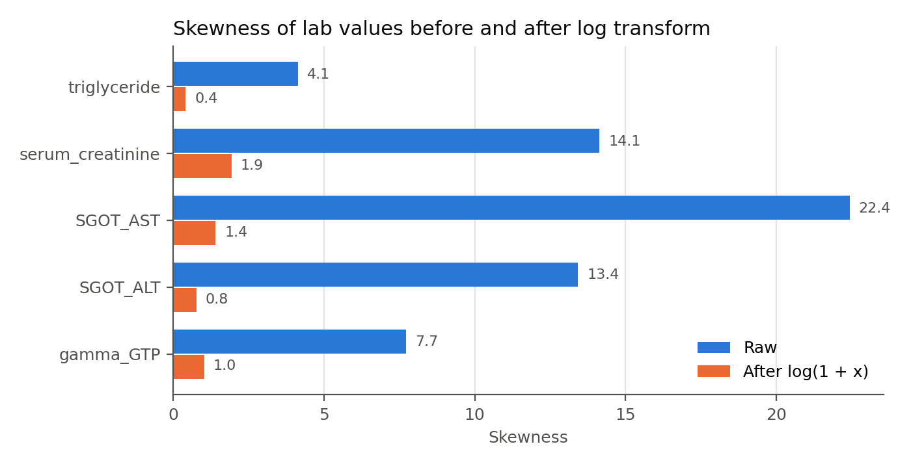
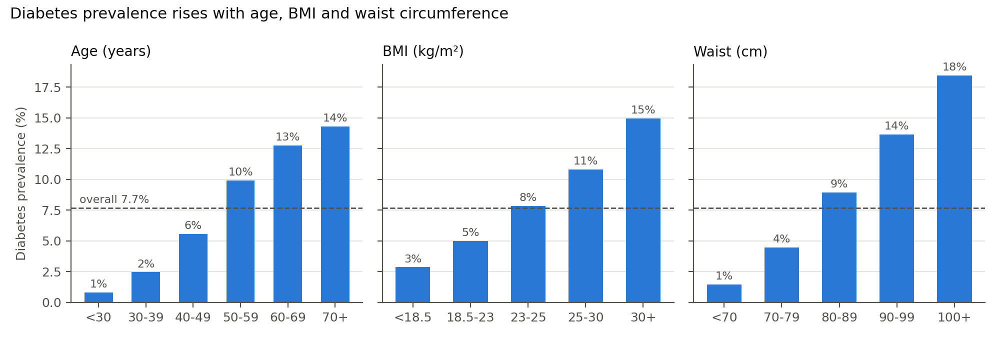

# 2.0 Preprocessing

All preprocessing code is in `task3/`: `data_exploration.py` produces the statistics and figures in 2.1, and `run_preprocessing.py` runs the pipeline described in 2.2 (`cleaning.py` → `feature_extraction.py` → `split.py` → `preprocessor.py`).

## 2.1 Data exploration

**Size and completeness.** The dataset has 991,346 records and 24 columns. There are no missing values, and 26 rows are exact duplicates.

**Target distribution.** 76,199 records (7.69 %) have a fasting glucose of at least 126 mg/dL and are labelled as diabetes. The classes are therefore strongly imbalanced, which affects metric choice (section 1.4) and the train/test split (2.2.7).

**Measurement resolution.** All height and weight values are multiples of 5, meaning the data provider rounded them to 5 cm and 5 kg intervals. Waist circumference is recorded more precisely (17 % of values have decimals). BMI computed from rounded height and weight is therefore coarse: at 170 cm, one 5 kg step changes BMI by about 1.7 kg/m². This lowers the precision of the body-size features and is noted as a limitation.

**Codes and implausible values.** Visual acuity contains the value 9.9 (3,118 left, 3,111 right). It is the dataset's code for blindness, not a measurement; the next-highest real acuity is 2.5. Several other columns contain values that are physiologically impossible and are most likely entry errors or placeholder codes:

| Column | Values outside plausible range | Extreme values |
|---|---|---|
| waistline | 71 | 8 cm, 999 cm |
| HDL cholesterol | 97 | 8,110 mg/dL |
| LDL cholesterol | 306 | 1 mg/dL, 5,119 mg/dL |
| triglyceride | 144 | 9,490 mg/dL |
| serum creatinine | 476 | 0.1 mg/dL, 98 mg/dL |
| SGOT AST | 7 | 9,999 U/L |
| fasting glucose (BLDS) | 30 | 25 mg/dL, 852 mg/dL |
| other columns (SBP, DBP, cholesterol, hemoglobin, ALT) | 72 | |
| **Total** | **1,203** | |

These 1,203 values occur in 1,160 rows (0.12 % of the data).

**Categorical variables.** Sex is balanced (53.1 % male), and so is drinking (50.0 % drinkers). Smoking status: 60.8 % never, 17.6 % former, 21.6 % current. Abnormal hearing is rare (about 3 %), and 94.3 % have a negative urine protein test.

**Skewness.** Five lab values are strongly right-skewed even after implausible values are removed (Figure 2.1). A small number of very high values would dominate the scale of these features in distance-based models.

*Figure 2.1: Skewness of the five skewed lab values before and after a log(1 + x) transform.*

**Relationship to the target.** Diabetes prevalence rises steadily with age, BMI and waist circumference (Figure 2.2). It ranges from 1 % in people under 30 to 14 % in people over 70, and from 1 % for a waist under 70 cm to 18 % for a waist over 100 cm. This confirms that the questionnaire features carry real signal. Smoking status relates to the target non-monotonically: prevalence is 6.3 % among never-smokers, 10.5 % among former smokers and 9.4 % among current smokers. Drinkers and non-drinkers differ little (7.5 % vs 7.8 %).

*Figure 2.2: Diabetes prevalence by age group, BMI category (WHO Asia-Pacific cut-offs) and waist circumference. The dashed line is the overall prevalence of 7.7 %.*

## 2.2 Preprocessing steps and justification

The pipeline has two stages, separated by the train/test split:

1. **Before the split:** row-level steps that learn nothing from the data (2.2.1–2.2.6). Applying them to the whole dataset cannot leak information from the test set, and they work identically on a single new patient.
2. **After the split:** steps that estimate statistics such as percentiles, medians, means and standard deviations (2.2.8–2.2.11). These are fitted on the training set only, inside an sklearn `ColumnTransformer` that is placed as the first step of every model `Pipeline`. During cross-validation the pipeline is refitted on each training fold, so the validation fold never influences the preprocessing either.

This is a deliberate change from assignment 1, where the scaler and the median imputer were fitted on the full dataset before any split.

### 2.2.1 Removing duplicates
The 26 exact duplicate rows are removed. Duplicates could end up in both the training and test set, which would let the model be evaluated on records it was trained on.

### 2.2.2 Creating the target and removing BLDS
The label is `diabetes = 1` when BLDS ≥ 126 mg/dL, following the ADA diagnostic threshold (American Diabetes Association, 2021, p. S17), and BLDS is then dropped. Keeping BLDS as a feature would be target leakage, because the label is a direct threshold on it. It would also contradict the real-world scenario, where new patients have no glucose value. The 30 rows with a physiologically impossible glucose value (below 40 or above 600 mg/dL) are deleted, because their label cannot be trusted. These are the only rows removed besides duplicates.

### 2.2.3 Recoding the blindness code
The value 9.9 in `sight_left` and `sight_right` is moved to two binary flags, `blind_left` and `blind_right`. The acuity value itself is set to missing and imputed later (2.2.10). Left as a number, 9.9 would be read as extremely *good* vision and would distort the scale of the feature. As a flag, the information is kept in a form that means what it says. Vision is only used by the comparison model (2.2.8).

### 2.2.4 Masking implausible values instead of deleting rows
Values outside wide, physiologically plausible ranges (e.g. waist 50–150 cm, HDL 10–200 mg/dL; the full list is in `config.py`) are set to missing rather than deleting the row. The ranges are deliberately wide, so they only catch the entry errors and placeholder codes described in 2.1, not extreme but real patients.

We mask instead of deleting because a screening tool cannot refuse a patient at deployment time. If one of a patient's measurements is clearly wrong, the sensible behaviour is to ignore that value and use the rest. Deleting rows during training would also quietly remove the hardest cases from the test set and make the evaluation look better than reality. Assignment 1 deleted rows with statistical outliers in height, weight and waist; we have replaced that with masking here and clipping in 2.2.9.

### 2.2.5 Encoding categorical variables
- **Sex, drinking and hearing** become 0/1 indicators (`male`, `drinker`, `hear_abnormal_left/right`), with names that state what 1 means. Hearing is only used by the comparison model.
- **Smoking status** (never / former / current) is one-hot encoded into two indicators, with *never smoked* as the reference category. Treating it as an ordinal number 1–3, as in assignment 1, would assume that risk increases from never to former to current. The data contradicts this: former smokers have higher prevalence than current smokers (2.1).
- **Urine protein** (dipstick result − to 4+) is a genuinely ordered scale and is kept as a single ordinal number. It is only used by the comparison model.

### 2.2.6 Derived features
BMI (weight / height²) and waist-to-height ratio are added. They are ratios of features the patient already reports, and they are standard clinical markers of general and abdominal obesity. Because they are non-linear combinations of the inputs, they give linear and distance-based models information those models cannot construct on their own. We did not add pulse pressure or mean arterial pressure. The main model does not use blood pressure (2.2.8), and in the comparison model both would be linear combinations of systolic and diastolic pressure, adding no information while creating perfect multicollinearity for logistic regression. Section 3 justifies the derived features in detail.

### 2.2.7 Stratified train/test split
The data is split 80/20 (793,032 / 198,258 rows) with stratification on the label, so both sets keep the 7.68 % prevalence. Without stratification, random variation in the test-set prevalence would shift recall and precision between runs. The test set is used only for the final comparison; model selection and hyperparameter tuning use cross-validation on the training set. A fixed random seed makes every result reproducible.

### 2.2.8 Two feature sets
The same cleaned data feeds two feature sets, matching section 1.2:

| Feature set | Features after encoding | Content |
|---|---|---|
| `questionnaire` (main model) | 10 | age, sex, height, weight, waist, BMI, waist-to-height, smoking, drinking |
| `full` (comparison model) | 28 | everything above plus blood pressure, vision, hearing and the ten blood and urine values |

The questionnaire set contains only information a person can report themselves or measure at home with a scale and a tape measure. This makes it close in content to established questionnaire tools such as the ADA risk test (American Diabetes Association, 2021, p. S22). Three groups of features are excluded because they require professional equipment:
- **Blood pressure:** requires a blood-pressure monitor, which most people do not have at home.
- **Vision:** an acuity score from an eye-chart test at the check-up; people cannot report it precisely.
- **Hearing:** the result of a hearing test.

Including any of these would mean the tool could no longer be used as a pure self-assessment. In a preliminary test with a default gradient-boosting model, the self-report features reached a ROC-AUC of 0.748. Adding blood pressure, vision and hearing raised it only to 0.759, which we consider an acceptable price for a tool anyone can use without equipment.

### 2.2.9 Log transform and clipping of extreme values (fitted on train)
- **Log transform:** the five skewed lab values (full model only) are transformed with log(1 + x), which reduces their skewness from 4–22 to 0.4–1.9 (Figure 2.1). Lab values like these are usually log-normal, and on a log scale a doubling counts the same anywhere in the range. The questionnaire features are close to symmetric (|skewness| < 0.6) and are not transformed.
- **Clipping (winsorizing):** every continuous feature is then clipped to the 0.5th and 99.5th percentiles of the *training* data. This keeps all patients while preventing extreme but plausible values from dominating models that rely on distances or gradients (KNN, SVM, neural networks). Tree-based models are unaffected, because clipping preserves the order of the values.

### 2.2.10 Imputation (fitted on train)
The only missing values are the ones created in 2.2.3 and 2.2.4, which affect 0.68 % of rows. Continuous features are imputed with the training-set **median**, which, unlike the mean, is not pulled by skew or the remaining extreme values. Binary and ordinal features are imputed with the training-set mode. In the cleaned data these never contain missing values, but the imputers make the pipeline robust to an incomplete questionnaire at deployment time. With so few missing values, more advanced methods such as KNN imputation would not change the results enough to justify their cost on 800,000 rows.

### 2.2.11 Standardization (fitted on train)
Continuous and ordinal features are standardized to mean 0 and standard deviation 1, using the training-set mean and standard deviation. KNN and SVM use distances, and neural networks and regularized logistic regression use gradients or penalties. In all of these, a feature measured in large units (cholesterol in mg/dL) would otherwise outweigh one measured in small units (waist-to-height ratio around 0.5). Tree-based models do not need scaling, but it does not harm them, so one pipeline serves all models. The 0/1 indicators are left unscaled to keep their interpretation.

### 2.2.12 Decisions deliberately left out of preprocessing
- **Class imbalance is not resampled here.** Oversampling or undersampling would have to happen inside each cross-validation fold to avoid leakage. It would also distort the predicted probabilities that the referral threshold depends on. We handle imbalance at model level instead, through class weights and the choice of decision threshold, and evaluate with recall and PR-AUC (section 1.4).
- **Subsampling for expensive models.** Kernel SVM training scales roughly quadratically to cubically with the number of samples, and KNN must compare each prediction to every training point. `split.stratified_subsample` therefore draws a smaller stratified sample of the training set for those models, keeping the class balance. The sample size is decided in section 5.

### 2.2.13 Summary of changes from assignment 1

| Assignment 1 | Assignment 3 | Reason |
|---|---|---|
| Scaler and imputer fitted on the full dataset | Fitted on training data only, inside a pipeline | Prevents test-set leakage |
| Rows with statistical outliers deleted | Implausible values masked and imputed; extreme values clipped | Deployment cannot drop patients; deletion inflates test scores |
| Smoking status scaled as a number | One-hot encoded | Risk is not ordered by smoking status (2.1) |
| Sight value 9.9 left as a number | Moved to a blindness flag | 9.9 is a code, not a measurement |
| BLDS kept as a feature | Used only to create the target | It defines the label (leakage) and is unavailable at screening time |
| — | Log transform of skewed labs, derived BMI and waist-to-height, two feature sets (self-report only vs. all measurements) | Suit the questionnaire scenario and the comparison model |
