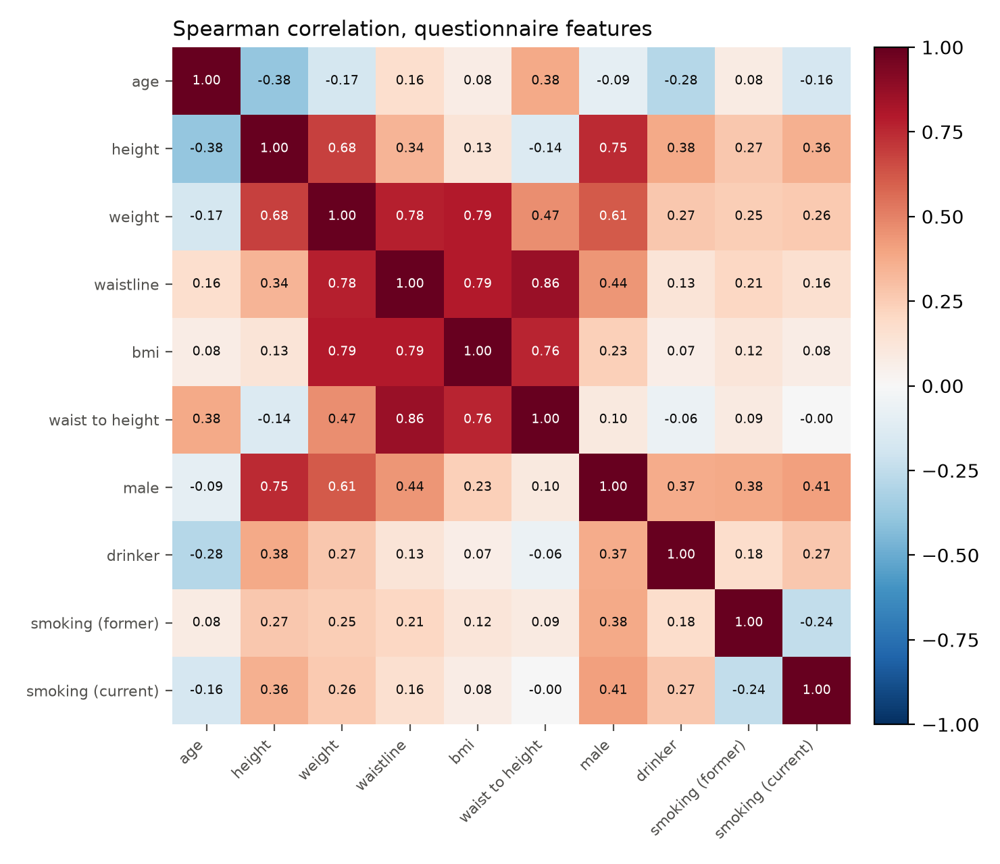
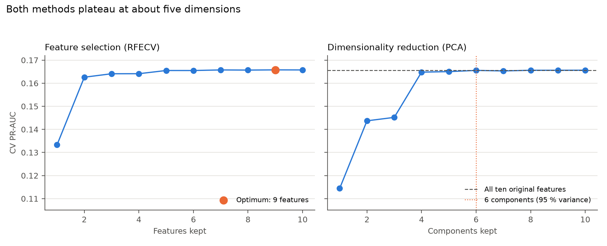
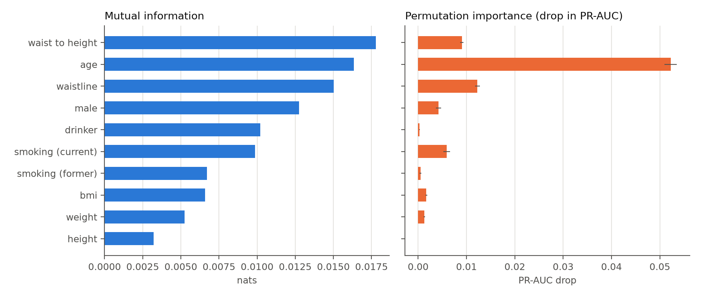

# 4.0 Feature Selection and Dimensionality Reduction

Section 2.2.8 fixed the main model at ten questionnaire inputs. This section asks whether that set
is larger than it needs to be. Both feature selection and dimensionality reduction were tried on
the training split, compared on the same folds, and used to decide what belongs in the final
pipeline. Everything that learns from data was fitted on the training set only, so the test set was
not used.

## 4.1 The question and the criterion

The training set has 793,032 rows and the questionnaire model has ten inputs, which is about 79,000
rows per feature. Dimensionality reduction is usually worth doing when there are many features
compared with the number of observations, and that is not the case here. The only reasons to reduce
anything would therefore be that some features repeat the same information, or that a smaller set
predicts better.

The only redundancy we expected was in body size. BMI and waist-to-height ratio are calculated
directly from height, weight and waist circumference, so those four columns describe partly the same
thing. They were the natural candidates for removal, or for being combined into components.

Every option was scored on PR-AUC, because only 7.68 % of patients are positive and accuracy would
be misleading (section 1.4). All options used the same stratified five-fold cross-validation on the
training set, and every selection step was refitted inside each fold, so a validation fold never
influenced which features were kept. A difference below 0.001 PR-AUC, about 0.6 % of the full
model's score, was treated as noise. A feature was only worth removing if it removed a measurement
the patient has to provide. Dropping a column that is needed to calculate a feature we keep does
not save anything in practice.

## 4.2 Correlation between the features

Figure 4.1: Spearman correlation between the ten questionnaire features on the training set. Eight
of the 45 pairs exceed 0.5, and none exceeds 0.87.

Eight of the 45 pairs correlate above 0.5 (Figure 4.1). The strongest is waist circumference against
waist-to-height ratio (0.86). BMI correlates with weight and with waist circumference (both 0.79),
and waist circumference correlates with weight (0.78). Height and male correlate at 0.75, but that
is mostly because men in this dataset are taller, not because the two columns measure the same
thing.

The correlations are high, but none is close to 1, so no column is a copy of another. This is
expected, because BMI and waist-to-height ratio are non-linear combinations of the raw measurements;
their linear correlation with those measurements is strong but not perfect. The collinearity is
therefore real but moderate. The L2 penalty in the logistic regression handles it, and tree-based
models are unaffected by it, so no column had to be removed just to make the model work.

## 4.3 Dimensionality reduction with PCA

Principal component analysis (PCA) was fitted on the standardized training features (Jolliffe,
2002). For this part, all ten columns were put on unit variance, including the 0/1 indicators. PCA
looks for directions with as much variance as possible, and an indicator with standard deviation 0.5
would otherwise count less than the continuous features just because of its scale.

The first component explains 38.7 % of the variance and is mostly body size: weight (0.48), waist
circumference (0.45), BMI (0.40) and male (0.35) all load in the same direction. The second explains
23.8 % and contrasts age (0.42) and waist-to-height ratio (0.48) with height (-0.43). The third
explains 12.6 % and is basically smoking, with former (0.77) against current (-0.54). Five
components keep 91.6 % of the variance and six keep 95.5 %.

Figure 4.2 (right) shows a logistic regression trained on the first k components. With six
components the PR-AUC is 0.1656, which is the same as with all ten original features. Five
components reach 0.1650, a loss of 0.0006, and four reach 0.1648. Only at three components does the
model get clearly worse (0.1452). The first four to six components therefore carry almost all of
the predictive information.

Figure 4.2: Cross-validated PR-AUC against the number of features kept (left) and principal
components retained (right). Both curves reach the ten-feature score at about five dimensions.

That still does not make PCA a good choice here. It reduces what goes into the model, but not what
the patient has to answer. To calculate six components for a new patient, all ten measurements are
still needed. The only saving is in model size, not in the questionnaire or in what the clinician
has to type in. A component is also a weighted sum of several measurements, so a prediction can no
longer be explained as "age 58, BMI 31, waist-to-height ratio 0.61".

KNN was also tested, because that is the model where removing correlated inputs could actually
help. On a stratified sample of 30,000 rows, the ten raw features reached PR-AUC 0.1232 and five
components reached 0.1223, so there was no improvement. Both are far below the logistic regression,
so KNN is not competitive here with or without PCA.

## 4.4 Feature selection

Three selection methods were used, because each one misses something the others see. Mutual
information is a filter: it finds non-linear relationships without a model, but it looks at each
feature on its own and cannot tell whether two features carry the same information (Guyon &
Elisseeff, 2003). L1 logistic regression is embedded: it selects while it fits, but with correlated
features it picks one somewhat arbitrarily and can change its mind when the penalty changes.
Permutation importance and recursive feature elimination with cross-validation (RFECV) are wrapper
methods: they measure how much a feature adds given the others, which is what matters for the
model, but they depend on the fitted model and take longer to run (Breiman, 2001).

Permutation importance was measured on a held-out fifth of the training set, with ten shuffles.
RFECV removed one feature at a time with the same five folds and the same PR-AUC criterion.

| Feature | Mutual information | Permutation (drop in PR-AUC) | L1 (of 7 strengths) | RFECV |
|---|---|---|---|---|
| waist-to-height ratio | 0.0178 | 0.0091 | 5 | kept |
| age | 0.0163 | 0.0522 | 7 | kept |
| waistline | 0.0150 | 0.0122 | 7 | kept |
| male | 0.0128 | 0.0042 | 7 | kept |
| drinker | 0.0102 | 0.0003 | 7 | kept |
| smoking (current) | 0.0099 | 0.0059 | 7 | kept |
| smoking (former) | 0.0067 | 0.0005 | 7 | kept |
| BMI | 0.0066 | 0.0017 | 7 | kept |
| weight | 0.0052 | 0.0013 | 3 | kept |
| height | 0.0032 | 0.0000 | 5 | dropped |

Table 4.1: Selection results for the ten questionnaire features, ordered by mutual information. The
L1 column counts how many regularization strengths on the path kept a non-zero coefficient.

Figure 4.3: Mutual information and permutation importance for the ten questionnaire features. Error
bars are one standard deviation over ten shuffles.

Age is the most important feature by a clear margin (Figure 4.3). Its permutation importance is 0.0522, four
times the next one (waist circumference, 0.0122). Mutual information ranks waist-to-height ratio
and waist circumference above age, but once age is in the model the other features add much less.
The model is mostly an age and body-size model, which is consistent with the prevalence curves
(2.1).

The methods disagree about drinking, which is worth noting. Drinking is fifth on mutual information
(0.0102) but ninth on permutation importance (0.0003). The association on its own is real, but once
age, waist circumference and smoking are in the model it adds almost nothing. This is the difference
between a filter and a wrapper, and it is why both were run.

L1 was unstable among the body-size features. It kept eight of ten coefficients at C ≤ 0.1 and all
ten at C ≥ 0.3, and the two it dropped changed with the penalty. At C = 0.1 it dropped weight and
waist-to-height ratio, even though mutual information ranks waist-to-height ratio first. Table 4.1
shows this: weight is kept at only 3 of 7 strengths, and height and waist-to-height ratio at 5 of 7.
L1 is therefore reported but not relied on alone to remove a feature.

Height is the only feature that RFECV removes, and the top-nine mutual-information ranking removes
the same one. It has the lowest mutual information and a permutation importance of zero. The
nine-feature model scores 0.1657 against 0.1656 for all ten (Table 4.2). That difference is noise,
and height is still needed to calculate BMI and waist-to-height ratio, so removing the column does
not remove a measurement.

The curve in Figure 4.2 (left) also levels off early. Five features already reach 0.1655, and two
features, age and waist circumference, reach 0.1626. A shorter five-item questionnaire is therefore
possible, but it is left as future work. The main model remains on the full questionnaire because
that is the design fixed in sections 1.2 and 2.2.8, and the extra questions are quick to answer.

## 4.5 Decision and justification

The final pipeline keeps all ten questionnaire features and does not use PCA. Table 4.2 shows the
comparison.

| Option | Inputs | PR-AUC | ROC-AUC |
|---|---|---|---|
| All ten features | 10 | 0.1656 | 0.7421 |
| RFECV, height dropped | 9 | 0.1657 | 0.7421 |
| PCA, 95 % variance | 6 | 0.1656 | 0.7418 |

Table 4.2: Cross-validated performance of the three options on identical folds.

All three options are within 0.0001 PR-AUC of each other, far below the noise level set in 4.1, so
neither method improves performance. The only feature that RFECV removes, height, still has to be
measured to calculate BMI and waist-to-height ratio, so dropping the column does not make the
questionnaire shorter. PCA reaches the same PR-AUC with six components, but it still needs all ten
measurements, and a component is a weighted sum that cannot be explained to a clinician.
Interpretability matters here because sections 1.3 and 1.4 require a model whose risk factors can
be explained, and the decision tree in 5.3 is included partly for the same reason.

There is also no real need to rotate the features. The L2 penalty already handles the collinearity,
and with all components the ridge penalty is unchanged by a rotation, so PCA only matters if
components are discarded. Tree-based models do not need decorrelated inputs at all.

The analysis was still useful. The correlation matrix showed that both derived features are worth
keeping: they are correlated with their inputs, but not redundant, and they give linear and
distance-based models a non-linear combination those models cannot construct on their own. The
selection results also show that the ten-feature set is not wasteful, which is the justification
required when no reduction is applied at the end.

The comparison model is a different case. In its mutual information ranking, gamma-GTP ranks fourth
(0.0143), above male and smoking, and triglyceride, SGOT ALT and SBP are also in the top ten. The
blind flags are at the bottom, close to zero. The blood and urine values therefore add information
that the questionnaire does not have, and section 6 measures how much that is worth.

## 4.6 Limitations

RFECV is slightly optimistic, because the number of features is chosen on the same folds that are
then reported. No outer cross-validation loop was added. The difference between nine and ten
features is noise anyway, so the decision is not affected.

The importance scores are based on a linear model. Mutual information does not use a model, but
permutation importance was measured on a logistic regression, and a tree could rank the features
differently. The fact that mutual information, permutation importance and RFECV all agree on height
is what makes that conclusion safe.

The scores are also modest in absolute terms. A PR-AUC of 0.166 against a base rate of 0.077 means
the questionnaire separates the classes about 2.2 times better than chance. That is expected from
self-reported measurements alone. It is the reason for the comparison with the lab model, not a
problem with the feature set.

Finally, mutual information (100,000 rows) and the L1 path (200,000 rows) were fitted on stratified
samples to keep the run time down. Both are ranking exercises, so the order of the features is not
expected to change, but the exact values would shift slightly on the full data.

## References to add to the literature list

Breiman, L. (2001). Random forests. Machine Learning, 45(1), 5–32.
https://doi.org/10.1023/A:1010933404324

Guyon, I., & Elisseeff, A. (2003). An introduction to variable and feature selection. Journal of
Machine Learning Research, 3, 1157–1182.

Jolliffe, I. T. (2002). Principal component analysis (2nd ed.). Springer.
https://doi.org/10.1007/b98835
