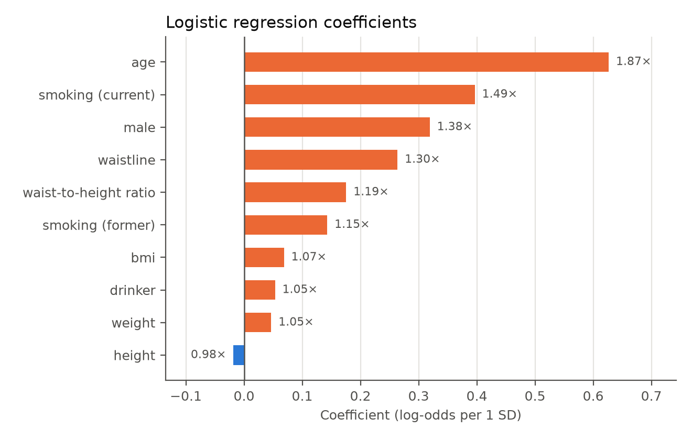
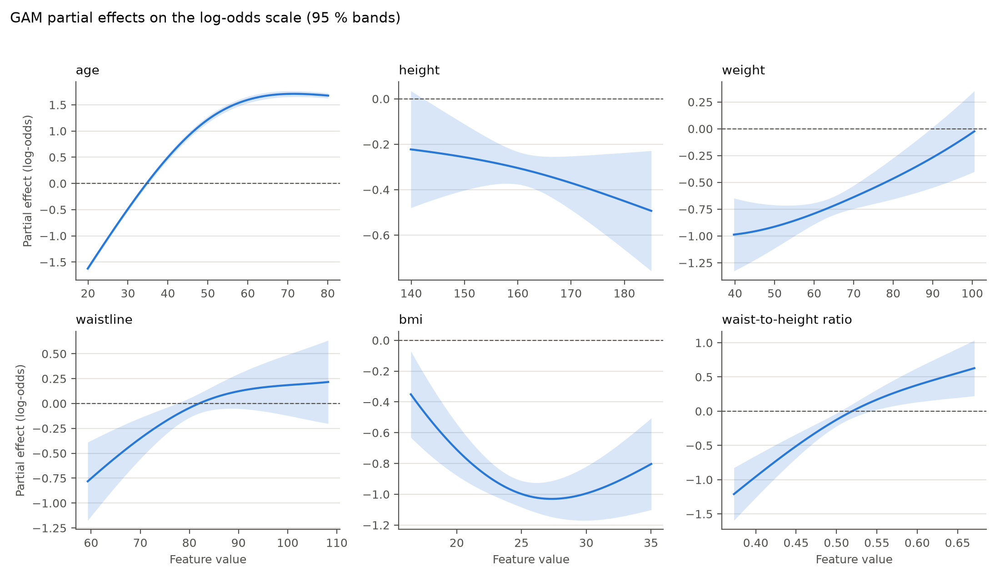
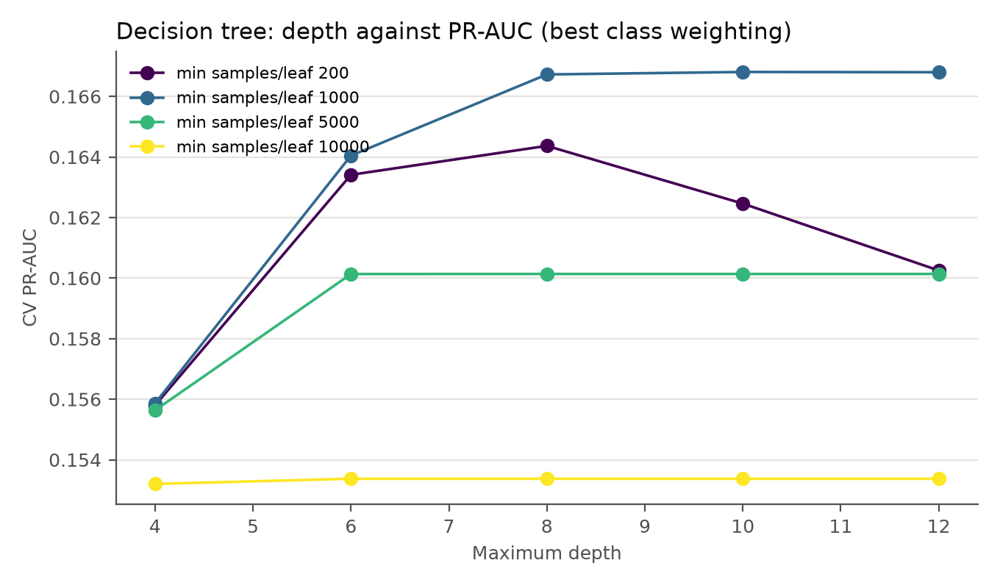
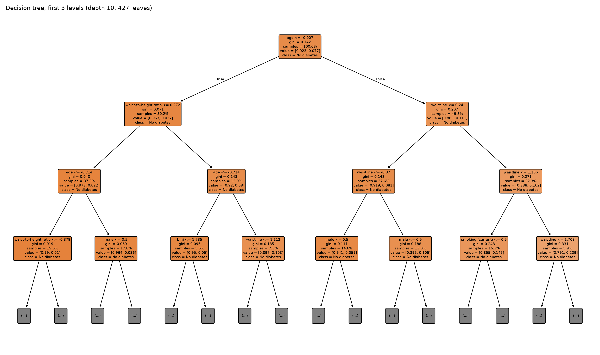
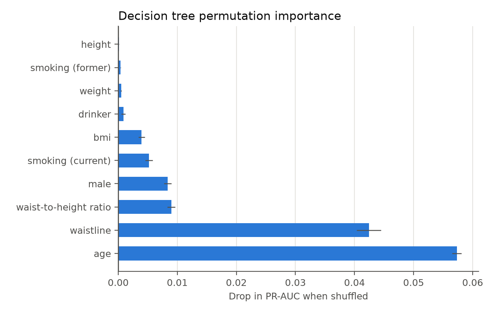

# 5.0 Algorithms

Section 2.2.8 fixed the main model at ten questionnaire inputs. This section implements three
classifiers on that feature set: logistic regression, a generalized additive model (GAM), and a
decision tree. They are not three interchangeable candidates. They form a deliberately ordered
ladder of assumptions: a linear model, an additive model that relaxes linearity but keeps
additivity, and a tree that allows interactions and thresholds at the cost of variance. Comparing
them shows which part of the structure matters for this problem, and gives the baseline that
sections 6–10 build on.

All three models are fitted on the same ten questionnaire inputs and evaluated on the same
cross-validation folds and held-out test set. The sections below describe the assumptions of each
model, the hyperparameters that were tuned, and how the fitted model is read.

## 5.1 Why these three, and why not the others

The three models were chosen for four reasons.

1. **They match the clinical requirement.** Section 1.3 requires that a clinician can see why a
   patient was flagged. A coefficient, a partial-effect curve, or a decision path is directly
   explainable. This is also why the main model is not a black box at this stage.
2. **They cover different assumptions.** Logistic regression can only represent additive linear
   effects. The GAM keeps additivity but allows each continuous feature to bend. The tree can
   represent interactions and sharp thresholds. If the GAM and the tree add little over the linear
   model, the signal is mostly linear and additive; if they add a lot, the linear model was
   misspecified. That is a useful diagnostic, not just a model race.
3. **They scale to 793,032 training rows.** All three fit in seconds (the GAM in about 20 s) and
   predict in milliseconds per 100,000 patients. A screening tool applied to a whole population
   cannot rely on a model whose prediction cost grows with the training set.
4. **They are the natural baselines for the ensembles.** Section 7 needs a basic model to boost
   and bag, and section 10 needs a complexity ladder. Using the same three models throughout keeps
   the comparison honest.

The alternatives were excluded for concrete reasons, not because they are bad models in general:

- **K-nearest neighbours.** Section 4.3 already measured KNN on the same features: PR-AUC 0.1232
  on a 30,000-row sample, far below the logistic regression. Prediction is also linear in the
  training-set size, which is the wrong cost profile for population screening.
- **SVM with kernels.** Training scales roughly quadratically to cubically with the number of
  rows, so 793,032 rows would require a stratified subsample and a long fit. The output is also a
  margin score rather than a calibrated probability, and section 1.4 needs a probability to choose
  a referral threshold.
- **Naïve Bayes.** It assumes conditional independence of the features. Section 4.2 shows that the
  body-size columns correlate at 0.76–0.86 (BMI–waist-to-height 0.76, waist–BMI 0.79), so that
  assumption is clearly violated.
- **Neural network.** It is the subject of section 9. Including it here would duplicate the later
  comparison and remove the simple baseline that the deep model should beat.

The handout lists "Regression (linear or polynomial)". Logistic regression is the linear
classifier in that slot: it is a generalized linear model with a logit link, not a regression on a
continuous target. The report keeps the name *logistic regression* because that is what the model
is.

Two baselines are carried from section 1.4: a majority-class classifier and an untuned logistic
regression with default regularization. The majority baseline always predicts the negative class
at the default 0.5 threshold, so recall is 0. At the recall-0.80 threshold used here it degenerates
to referring every patient: recall 1 and precision equal to the 7.7 % prevalence (Table 6.1). The
gap between that and the real models is the value the questionnaire adds. The untuned model shows
how much of the tuned model's performance comes from tuning rather than from the features.

## 5.2 Evaluation protocol

- **Cross-validation.** Five stratified folds on the 793,032-row training set. Clipping,
  imputation and scaling are refitted on each training fold rather than estimated once on the
  whole training set, so the validation fold never influences the preprocessing.
- **Hyperparameter search.** Logistic regression is tuned on the full training set; the GAM and
  the tree are tuned on stratified samples (150,000 and 300,000 rows, three folds) and then refit
  on all 793,032 rows. The samples are used only to choose hyperparameters, never to report the
  final score.
- **Threshold.** The screening decision needs a threshold, not just a ranking. For every model the
  threshold is the largest value whose out-of-fold recall is at least 0.80. A larger threshold
  refers fewer patients and gives higher precision; the constraint keeps recall at the level
  required by section 1.4. The threshold is then frozen and applied once to the test set.
- **Metrics.** PR-AUC (average precision) is primary because only 7.68 % of patients are positive.
  ROC-AUC, Brier score and log loss are secondary. At the operating point we report recall,
  precision, F2 (which weights recall above precision), referral rate and the confusion matrix.
- **Test set.** Used once per model, after the threshold is fixed. No test observation influenced
  the features, the hyperparameters or the threshold.

## 5.3 Logistic regression

The model is

$$
\operatorname{logit} P(y=1 \mid x) = \beta_0 + \sum_{j=1}^{10} \beta_j x_j,
\qquad
P(y=1 \mid x) = \frac{1}{1 + e^{-\eta(x)}},
$$

with an L2 penalty on the coefficients. It assumes that the log-odds are a linear function of the
features: each additional year of age, centimetre of waist or unit of BMI changes the log-odds by
a constant amount, and the effects of different features add up. That is a strong assumption, but
it is exactly the assumption a clinician can read and challenge.

The search covered regularization strengths from $C = 0.003$ to $C = 1$, with and without
balanced class weights. The result is almost flat: every regularization strength between 0.003 and
1 gives a cross-validated PR-AUC between 0.1658 and 0.1659, and balanced class weighting is
slightly worse (0.1651). The selected model therefore uses the strongest penalty on the grid
($C = 0.003$) and no class weighting, but for practical purposes it is the same model as the
untuned baseline. The L2 strength is not what limits this model. That is itself informative: the
linear form, not the amount of regularization, is the binding constraint.

The coefficients, back-transformed to odds ratios per one standard deviation, are shown in
Figure 5.1.

*Figure 5.1: Logistic-regression coefficients on the standardized questionnaire features. Labels
are odds ratios per one standard deviation; a value above 1 means higher odds of diabetes.*

Age dominates: one standard deviation (14.2 years) multiplies the odds by 1.87. Current smoking
(1.49), male sex (1.38), waist circumference (1.30) and waist-to-height ratio (1.19) follow.
Former smoking is 1.15 and BMI 1.07. Height is essentially neutral (0.98) once the other body-size
columns are in the model, which matches its zero permutation importance in section 4.4. Drinker
and weight are both 1.05 and should not be over-interpreted: the coefficient is conditional on the
other correlated body-size features, and section 4.4 already showed that drinking adds almost
nothing once age, waist and smoking are present.

The coefficients are per standard deviation because the continuous features are standardized
before fitting. For clinical reading, the same coefficients expressed per unit are: age 1.045 per
year, waist 1.028 per cm, BMI 1.020 per kg/m², and waist-to-height ratio about 1.03 per 0.01.
These are associations in a screening model, not causal effects.

Cross-validated PR-AUC is 0.1659 ± 0.0021 and test PR-AUC is 0.1656. At the frozen threshold the
test recall is 0.7925, precision 0.1328, F2 0.3975, and 45.9 % of patients are referred. The
linear model is therefore a reasonable ranking model, but it misses the 0.80 recall target by
0.75 percentage points on the test set.

**Limitations.** The model cannot represent a threshold effect (for example, risk rising sharply
after a particular waist) or an interaction (for example, age modifying the effect of BMI). The
coefficients are also unstable under collinearity: the body-size columns share information, so
their individual signs and sizes should be read as conditional contributions, not as separate
mechanisms.

## 5.4 Generalized additive model

The GAM keeps the logit link but replaces the linear predictor with a sum of smooth functions:

$$
\operatorname{logit} P(y=1 \mid x) = \beta_0 + \sum_{j=1}^{6} f_j(x_j) + \sum_{k=1}^{4} \beta_k x_k.
$$

The six continuous features (age, height, weight, waist circumference, BMI and waist-to-height
ratio) get penalized cubic-spline terms; the four binary indicators (male sex, drinking, and the
two smoking indicators) stay linear. There are no interaction terms, so the model is still
additive: the effect of age does not depend on BMI. This is the smallest relaxation of the
logistic model that can represent the curved prevalence-age relationship visible in section 2.1.

The search covered the number of spline basis functions (5, 8 or 12) and the smoothing penalty
(0.1, 0.6, 1 or 10) on 150,000 rows with three folds. The best combination was five basis
functions and a smoothing penalty of 10: a relatively inflexible smooth per continuous feature.
The search score was 0.1707 PR-AUC, and the refit on the full training set reached 0.1732 ± 0.0021
cross-validated and 0.1721 on test.

The effective degrees of freedom show where the model spends its flexibility. Age uses 3.61 of
its 5 coefficients, weight 2.80, height 2.65, waist 2.49, BMI 2.17 and waist-to-height ratio 1.92.
The four linear terms use about one degree of freedom each, as they should. Age is the most
non-linear feature, which is consistent with the prevalence curve in section 2.1: risk rises
steeply through middle age and then flattens.

*Figure 5.2: GAM partial effects on the log-odds scale, with 95 % confidence bands. Each panel
varies one feature while the other terms are held at their fitted values.*

The partial effects are read as conditional contributions, not as marginal risk curves. Age rises
monotonically and plateaus after about 70. Waist circumference and waist-to-height ratio rise with
risk. Weight rises at the high end. BMI and height are negative once the other body-size terms are
in the model. That is not a claim that obesity protects against diabetes: weight, height, waist,
BMI and waist-to-height ratio are correlated, and the model splits their shared information among
several terms. The wide bands on the body-size panels reflect that collinearity. The marginal
prevalence curves in section 2.1 are the right place to read the unadjusted relationship; the GAM
panels answer a different question, namely what each column adds given the others.

**Limitations.** Additivity is still an assumption: the model cannot learn that the effect of
waist depends on age. The number of basis functions and the smoothing penalty are selected on a
subsample, and the partial effects are conditional on correlated columns. The GAM is also harder
to deploy than a linear model because it needs the spline basis and the smoothing parameters at
prediction time.

## 5.5 Decision tree

The tree is a CART classifier grown with the Gini impurity criterion. It partitions the feature
space into axis-aligned boxes and predicts the positive fraction in each leaf. Unlike the first
two models it can represent interactions and sharp thresholds without being told their form, and
a path from the root to a leaf is a rule a clinician can read.

The search covered maximum depths from 4 to 12 (and an unbounded tree), minimum leaf sizes of 200,
1,000, 5,000 or 10,000 patients, and unweighted versus balanced class weights, on 300,000 rows with
three folds. The selected tree has maximum depth 10, a minimum leaf size of 1,000 and no class
weighting. The search score was 0.1668 and the full-data refit reached 0.1708 ± 0.0020
cross-validated and 0.1708 on test. The depth curve (Figure 5.3) is almost flat between depth 8
and 12: the tree captures its useful structure early and then adds variance. The leaf-size
constraint matters more than depth, and the balanced class weights made the ranking slightly worse
and the probabilities badly calibrated, so the final tree is unweighted.

*Figure 5.3: Cross-validated PR-AUC against maximum depth for each minimum-leaf setting. The best
class weighting is shown at each point; the curve plateaus after depth 8.*

*Figure 5.4: The fitted tree, first three levels. The full tree has depth 10 and 427 leaves, grown
with a minimum of 1,000 samples per leaf; the figure is truncated for readability.*

The first splits are age, waist-to-height ratio and waist circumference, which is the same story
as the other two models. The permutation importances in Figure 5.5 confirm it: age costs 0.057
PR-AUC when shuffled, waist 0.042, waist-to-height ratio 0.009, male 0.008 and current smoking
0.005. Weight, former smoking and height are below 0.001. Impurity importance tells the same story
(age 0.47, waist 0.33), with the usual caveat that impurity importance favours features with many
possible split points.

*Figure 5.5: Permutation importance for the fitted tree, measured as the drop in PR-AUC on a
50,000-row sample. Error bars are one standard deviation over five shuffles.*

**Limitations.** A single tree is high-variance and unstable. It is also poorly calibrated when
class weights are used, because the leaf values are weighted fractions rather than observed
frequencies; the unweighted model avoids that problem (Brier 0.0671, close to the other two). The
axis-aligned splits cannot represent a smooth diagonal boundary, which is why the tree is a good
candidate for the bagging and boosting comparison in section 7.

## 5.6 Summary of the three models

Table 5.1 consolidates the out-of-fold results for the three models. The held-out comparison, the
operating point and the calibration analysis follow in §6.

| Model | PR-AUC | ROC-AUC | Brier | Log loss | Threshold | CV recall | CV precision | CV F2 | CV referral |
|---|---|---|---|---|---|---|---|---|---|
| Majority class | 0.0768 | 0.5000 | 0.0709 | 0.2710 | 0.0768 | 1.0000 | 0.0768 | 0.2939 | 1.0000 |
| Logistic (untuned) | 0.1658 ± 0.0021 | 0.7421 | 0.0676 | 0.2450 | 0.0639 | 0.8000 | 0.1334 | 0.4001 | 0.4608 |
| Logistic regression | 0.1659 ± 0.0021 | 0.7421 | 0.0676 | 0.2450 | 0.0643 | 0.8000 | 0.1335 | 0.4002 | 0.4606 |
| GAM | 0.1732 ± 0.0021 | 0.7475 | 0.0671 | 0.2421 | 0.0692 | 0.8000 | 0.1351 | 0.4032 | 0.4551 |
| Decision tree | 0.1708 ± 0.0020 | 0.7453 | 0.0671 | 0.2429 | 0.0733 | 0.8002 | 0.1343 | 0.4019 | 0.4577 |

*Table 5.1: Five-fold out-of-fold results on the 793,032 training rows. PR-AUC is reported as mean
± standard deviation across folds; the other metrics are means. The threshold is chosen on these
out-of-fold predictions to give recall ≥ 0.80.*

The three models are competitive on the same features. Section 6 evaluates them on the held-out
set, compares their operating points and calibration, and measures what the laboratory values add.

## 5.7 Limitations

- **One dataset, one label definition.** The label is a single fasting glucose measurement at the
  126 mg/dL threshold. Section 1.5 already notes that a clinical diagnosis requires a repeat test
  or HbA1c, so some labels are noisy. All three models inherit that noise.
- **No external validation.** The test set is a random hold-out from the same Korean NHIS data.
  Performance on another population, another age distribution or another measurement protocol is
  unknown.
- **Tuning is not nested.** The GAM and the tree are tuned on subsamples and then evaluated on the
  full training set with cross-validation. The selected hyperparameters are not re-selected inside
  every outer fold, so the reported scores are slightly optimistic. The differences between models
  are larger than the likely size of that optimism, but the absolute numbers should be read with
  that caveat.

## References used in this section

Breiman, L., Friedman, J. H., Olshen, R. A., & Stone, C. J. (1984). *Classification and regression
trees*. Wadsworth.

Hastie, T., Tibshirani, R., & Friedman, J. (2009). *The elements of statistical learning: Data
mining, inference, and prediction* (2nd ed.). Springer.

Hosmer, D. W., Lemeshow, S., & Sturdivant, R. X. (2013). *Applied logistic regression* (3rd ed.).
Wiley.

Molnar, C. (2022). *Interpretable machine learning: A guide for making black box models
explainable*. https://christophm.github.io/interpretable-ml-book/

Rudin, C. (2019). Stop explaining black box machine learning models for high stakes decisions and
use interpretable models instead. *Nature Machine Intelligence, 1*, 206–215.
https://doi.org/10.1038/s42256-019-0048-x

Wood, S. N. (2017). *Generalized additive models: An introduction with R* (2nd ed.). CRC Press.
