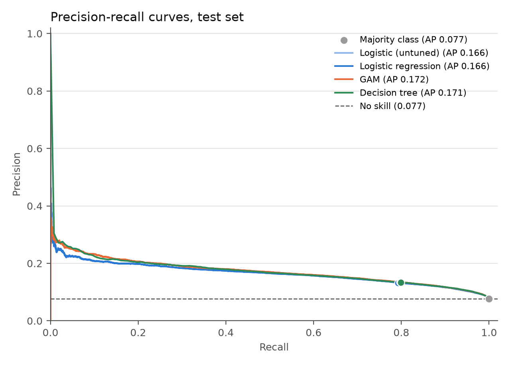
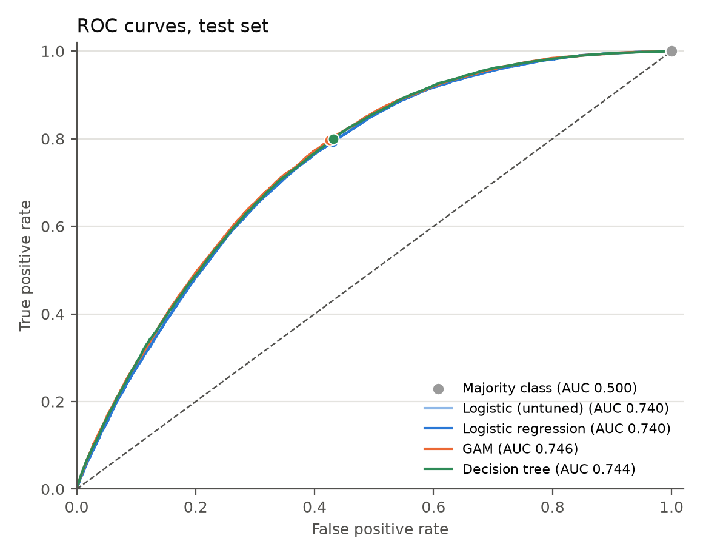
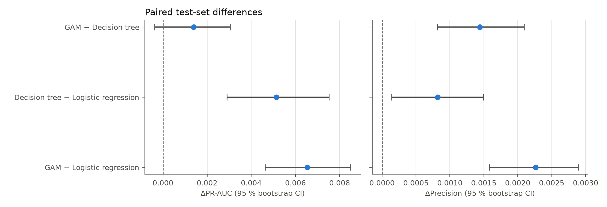
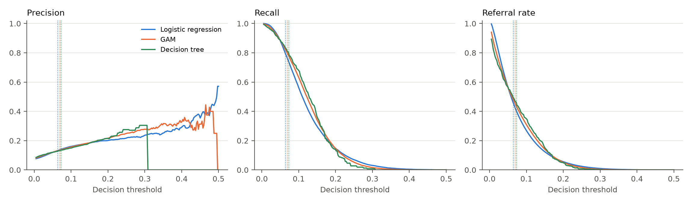
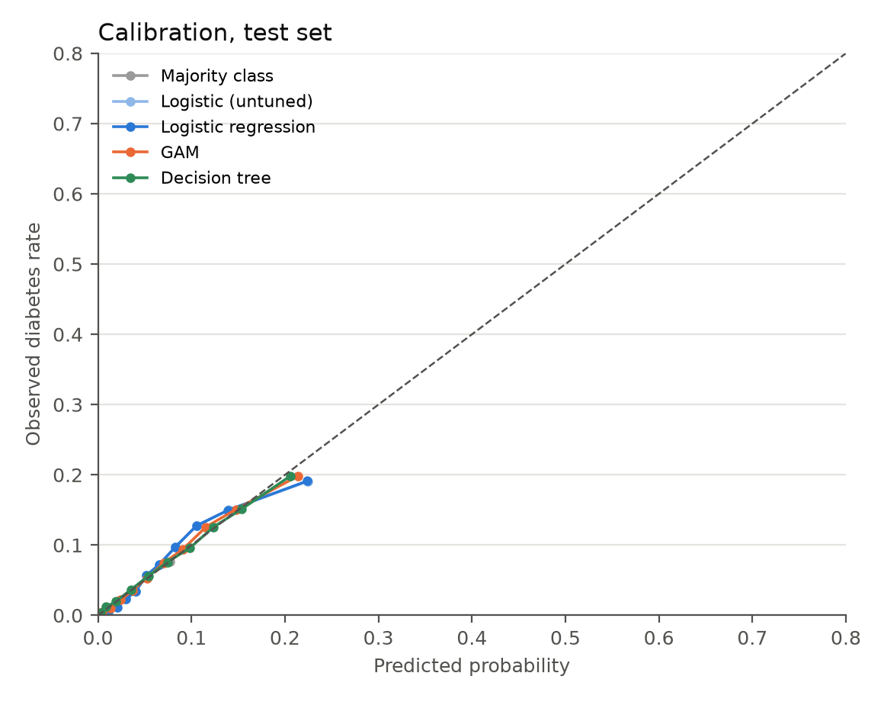
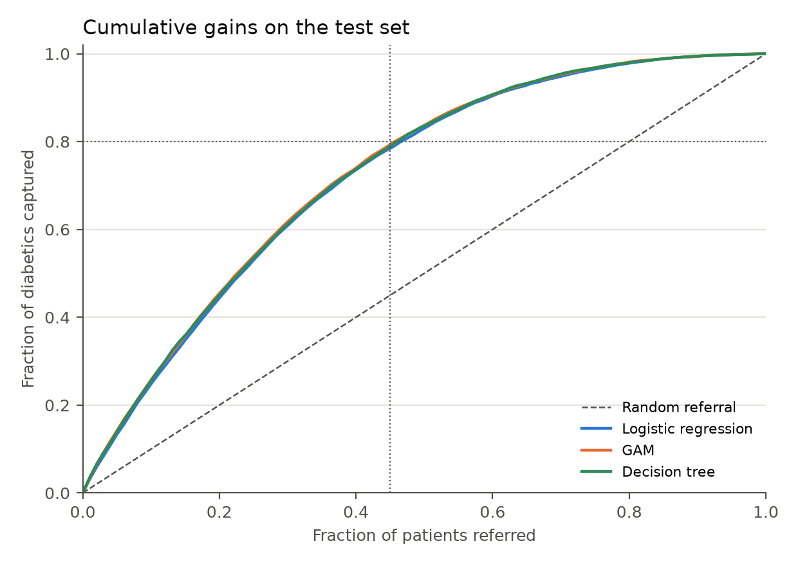
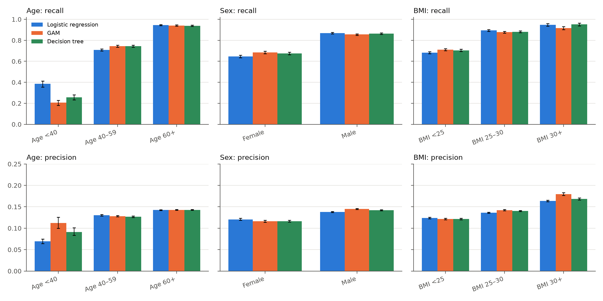
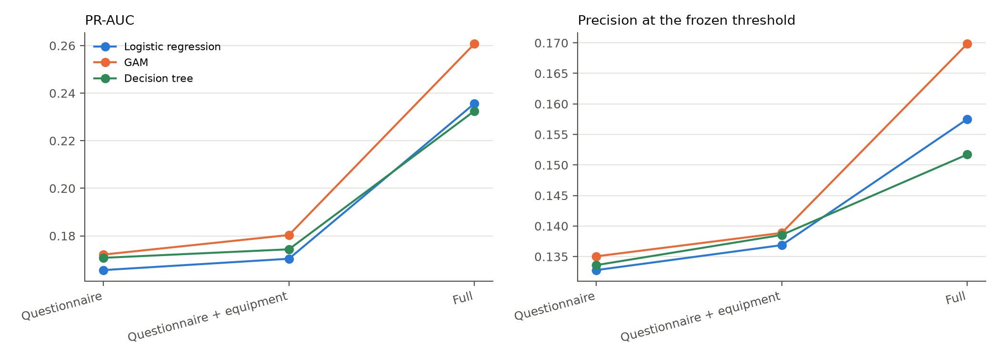

# 6.0 Comparison of the Three Algorithms

Section 5 established that logistic regression, the GAM and the decision tree are competitive on
the same ten questionnaire inputs. This section compares them on the held-out test set (198,258
rows, 15,236 positives, 7.685 %), using thresholds frozen from out-of-fold predictions at recall
≥ 0.80. The comparison asks how well each model ranks patients by risk, how well each performs as
a referral rule at the same recall, whether the probabilities are trustworthy, and what the
laboratory values add. No model is refitted, retuned or threshold-adjusted on the test set.

## 6.1 What is compared

Logistic regression, the GAM and the decision tree were fitted on the same ten questionnaire
features, evaluated on the same five stratified folds, and scored once on the same held-out test
set (198,258 patients, 15,236 positive). Each model's threshold was fixed on out-of-fold
predictions at recall ≥ 0.80 before the test set was used. The comparison asks how well each model
ranks patients by risk (PR-AUC, ROC-AUC) and how well each performs as a referral rule at the same
recall (precision, referral rate, missed cases). Calibration and clinical utility are treated
separately because the referral threshold is only meaningful if the predicted probabilities can be
trusted; §6.5 and §6.6 add the subgroup and feature-set analyses.

Table 6.1 gives the held-out results at the frozen thresholds. The untuned logistic regression and
the majority classifier are kept as references.

| Model | PR-AUC | ROC-AUC | Brier | Log loss | Recall | Precision | F2 | Referral | TP | FP | FN |
|---|---|---|---|---|---|---|---|---|---|---|---|
| Majority class | 0.0768 | 0.5000 | 0.0709 | 0.2710 | 1.0000 | 0.0768 | 0.2939 | 1.0000 | 15,236 | 183,022 | 0 |
| Logistic (untuned) | 0.1656 | 0.7399 | 0.0677 | 0.2454 | 0.7939 | 0.1328 | 0.3977 | 0.4596 | 12,096 | 79,016 | 3,140 |
| Logistic regression | 0.1656 | 0.7400 | 0.0676 | 0.2454 | 0.7925 | 0.1328 | 0.3975 | 0.4587 | 12,075 | 78,861 | 3,161 |
| GAM | 0.1721 | 0.7457 | 0.0671 | 0.2427 | 0.7970 | 0.1350 | 0.4024 | 0.4536 | 12,143 | 77,777 | 3,093 |
| Decision tree | 0.1708 | 0.7443 | 0.0671 | 0.2430 | 0.7992 | 0.1336 | 0.4003 | 0.4597 | 12,176 | 78,961 | 3,060 |

*Table 6.1: Test-set results at the thresholds frozen from the out-of-fold predictions. The test
set has 198,258 rows and 15,236 positives (7.685 %).*

## 6.2 Ranking performance

The GAM ranks best (test PR-AUC 0.1721), followed by the tree (0.1708) and logistic regression
(0.1656). The same order holds in cross-validation (0.1732, 0.1708, 0.1659) and for ROC-AUC
(0.7457, 0.7443, 0.7400). Relative to the 7.685 % no-skill prevalence, the average precision of
the three models is about 2.2 times higher.

The gap between the GAM and logistic regression is consistent across the test set and
cross-validation (0.0065 and 0.0073). The gap between the GAM and the tree is much smaller (0.0013
on test, 0.0024 in cross-validation). The fold-level standard deviation (about 0.0021) is shared
by all models, since they are evaluated on the same folds, and mainly reflects fold difficulty
rather than uncertainty in the differences. The paired fold differences are much tighter:
GAM−LR 0.0073 ± 0.0007, tree−LR 0.0049 ± 0.0013 and GAM−tree 0.0024 ± 0.0008. We therefore do not
rely on the per-model SD, and we do not claim a ranking between the GAM and the tree. The paired
bootstrap in Figure 6.3 is the formal test: only a difference whose interval excludes zero is
treated as a ranking. Both ensembles improve on
logistic regression; the GAM–tree difference is not distinguishable from zero.

Table 6.2 gives the paired test-set differences. A positive ΔPR-AUC, ΔROC-AUC, Δrecall,
Δprecision or ΔF2 favours the first model; a negative Δreferral means fewer patients referred.

| Comparison | ΔPR-AUC | ΔROC-AUC | Δrecall | Δprecision | ΔF2 | Δreferral | 95 % CI for ΔPR-AUC |
|---|---|---|---|---|---|---|---|
| GAM − logistic regression | +0.0065 | +0.0057 | +0.0045 | +0.0022 | +0.0049 | −0.0051 | [+0.0046, +0.0085] |
| Tree − logistic regression | +0.0052 | +0.0043 | +0.0067 | +0.0008 | +0.0028 | +0.0010 | [+0.0029, +0.0075] |
| GAM − tree | +0.0013 | +0.0014 | −0.0022 | +0.0014 | +0.0021 | −0.0061 | [−0.0004, +0.0030] |

*Table 6.2: Paired test-set differences. A positive ΔPR-AUC, ΔROC-AUC, Δrecall, Δprecision or
ΔF2 favours the first model; a negative Δreferral means fewer patients referred.*

*Figure 6.1: Precision-recall curves on the test set. Each dot is the frozen operating point; the
dashed line is the no-skill precision (7.685 % prevalence).*

*Figure 6.2: ROC curves on the test set. Each dot is the frozen operating point.*

*Figure 6.3: Paired test-set differences for PR-AUC and precision, with 95 % bootstrap confidence
intervals. The interval for GAM − tree includes zero.*

The ordering matches the ladder of assumptions from §5.1. The GAM improves on logistic regression
because it lets the continuous effects bend. Age uses 3.61 effective degrees of freedom, and its
partial effect rises steeply through middle age and flattens after about 70 (Figure 5.2).
Logistic regression forces a constant 4.5 % increase in odds per year across the whole range and
cannot represent this plateau. The tree can represent both thresholds and interactions, yet it
does not beat the GAM, even with 427 leaves. This suggests that interactions between the
questionnaire features add little beyond additive, non-linear effects, although a tree tuned for
stability may be a weak detector of interactions. Finally, all three models end up within 0.007
PR-AUC of each other despite very different assumptions. This points to the features, not the
algorithm, as the limit. Age, waist circumference and smoking carry most of the signal in every
model (§4.4, Figures 5.1 and 5.5), and no model can recover information that self-reported
measurements do not contain.

The bootstrap confirms the pattern: GAM − logistic regression is +0.0065 PR-AUC
(95 % CI +0.0046 to +0.0085), tree − logistic regression is about +0.0051 (+0.0029 to +0.0075),
and GAM − tree is +0.0013 (−0.0004 to +0.0030). The first two intervals exclude zero; the third
does not.

## 6.3 The screening operating point

The frozen thresholds produce slightly different recalls (0.7925, 0.7970 and 0.7992), so test-set
precision should not be compared directly. The test recalls differ because each threshold was
fixed on a different out-of-fold score distribution and then applied to a new sample; test
precision at those thresholds is therefore descriptive, not like-for-like. The out-of-fold results
in Table 5.1 are the fair comparison, since all three models were tuned to recall 0.80 there. At
that recall, precision is 0.1335 for logistic regression, 0.1351 for the GAM and 0.1343 for the
tree, and the referral rates are 46.1 %, 45.5 % and 45.8 %.

| Model | Recall | Precision | Referral | F2 | NNS | FP per TP | Cases found (TP) | False alarms (FP) | Missed (FN) |
|---|---|---|---|---|---|---|---|---|---|
| Majority class | 1.0000 | 0.0768 | 1.0000 | 0.2939 | 13.02 | 12.01 | 15,236 | 183,022 | 0 |
| Logistic (untuned) | 0.7939 | 0.1328 | 0.4596 | 0.3977 | 7.53 | 6.53 | 12,096 | 79,016 | 3,140 |
| Logistic regression | 0.7925 | 0.1328 | 0.4587 | 0.3975 | 7.53 | 6.53 | 12,075 | 78,861 | 3,161 |
| GAM | 0.7970 | 0.1350 | 0.4536 | 0.4024 | 7.41 | 6.40 | 12,143 | 77,777 | 3,093 |
| Decision tree | 0.7992 | 0.1336 | 0.4597 | 0.4003 | 7.49 | 6.49 | 12,176 | 78,961 | 3,060 |

*Table 6.3: Test-set outcome at the frozen operating point. NNS = 1 / precision, the number of
patients who must be referred to find one true case. FP per TP = false positives per true
positive.*

Relative to the baselines, all three models reduce referrals from 100 % of patients to about 45 %
while still finding roughly 80 % of cases. Precision rises from the 7.685 % base rate to
13.3–13.5 %, about 1.73 to 1.76 times higher. In practice, about 7.4 to 7.5 people are referred
per case found, compared with about 13 if everyone were tested. About one diabetic patient in five
is still missed (3,060 to 3,161 patients), and 86 % to 87 % of referrals are false alarms. The
success criterion in §1.4 is therefore only partly met: recall is close to 0.80 but slightly under
it on the test set, and precision is higher than the base rate but not “well above” it.

The differences between models are small in patient terms. Compared with logistic regression, the
GAM finds 68 more cases and produces 1,084 fewer false alarms on the test set. At the frozen
thresholds that is about 510 fewer referrals, and about 550 fewer false alarms, per 100,000 people
screened. The tree finds 101 more cases than logistic regression but also produces 100 more false
alarms, and compared with the GAM it finds 33 more cases at the cost of 1,184 more false alarms.
The tree's recall advantage is therefore bought with referrals, not with better discrimination.

Cost and stability do not change this picture much. The GAM is the slowest to fit (19.8 s against
1.4 s for logistic regression), but training happens once, and predicting 100,000 patients takes
208 ms, so the cost is negligible even at population scale. The more relevant costs are deployment
and stability. The GAM needs the spline basis and smoothing parameters at prediction time, and the
tree changes its lower splits with a different seed or leaf size.

*Figure 6.4: Precision, recall and referral rate against the decision threshold. Dotted vertical
lines mark each model's frozen threshold.*

## 6.4 Calibration

*Figure 6.5: Calibration on the test set. Logistic regression and the GAM track the diagonal
closely; the unweighted tree is also well calibrated.*

All three models are close to the diagonal. The Brier scores are 0.0671–0.0676 and the log losses
0.2427–0.2454, against 0.0709 and 0.2710 for the majority baseline. Calibration slopes are 0.996
for logistic regression, 0.989 for the GAM and 0.932 for the tree; the corresponding intercepts
are −0.010, −0.023 and −0.144. The 95 % bootstrap intervals are narrow: Brier 0.0675–0.0678,
0.0670–0.0673 and 0.0670–0.0673; log loss 0.2446–0.2464, 0.2418–0.2436 and 0.2421–0.2441. The
tree is well calibrated only because it is unweighted; the balanced version used in the
hyperparameter search produced weighted leaf fractions and a much worse Brier score.

Calibration matters for two reasons. First, the referral decision is a threshold on a probability,
so a model whose probabilities are systematically too high or too low will refer the wrong number
of patients. Second, a screening tool that reports “your risk is 18 %” should mean it. Ranking
metrics alone cannot detect this.

The tree's slope is slightly below one (0.93) and its intercept is negative, but its calibration
curve remains close to the diagonal over the observed risk range.

## 6.5 Clinical utility and error analysis

*Figure 6.6: Cumulative gains on the test set. The dashed diagonal is random referral; the dotted
lines mark 45 % referred and 80 % captured.*

At 45 % referred, the models capture 78.8 % (logistic regression), 79.4 % (tree) and 79.8 %
(GAM) of cases. Reaching 80 % requires 46.5 % (GAM and tree) or 47.5 % (logistic regression). The
lift over random referral is therefore about 1.7–1.8. The gains curve answers the question a clinic
actually asks: if we can only screen a fraction of the population, how many cases do we find? It is
a more natural summary than PR-AUC for a population-level programme, and it makes the cost of a
higher recall target visible.

*Figure 6.7: Recall and precision by age, sex and BMI subgroup, with 95 % bootstrap intervals.*

| Subgroup  | n       | Prevalence | LR recall | LR precision | GAM recall | GAM precision | Tree recall | Tree precision |
| --------- | ------- | ---------- | --------- | ------------ | ---------- | ------------- | ----------- | -------------- |
| Age <40   | 49,769  | 0.0193     | 0.3853    | 0.0691       | 0.2056     | 0.1124        | 0.2565      | 0.0913         |
| Age 40–59 | 97,796  | 0.0773     | 0.7093    | 0.1305       | 0.7446     | 0.1282        | 0.7446      | 0.1269         |
| Age 60+   | 50,693  | 0.1324     | 0.9447    | 0.1426       | 0.9409     | 0.1427        | 0.9385      | 0.1429         |
| Female    | 93,091  | 0.0559     | 0.6463    | 0.1207       | 0.6836     | 0.1162        | 0.6745      | 0.1164         |
| Male      | 105,167 | 0.0954     | 0.8683    | 0.1381       | 0.8558     | 0.1447        | 0.8638      | 0.1421         |
| BMI <25   | 131,299 | 0.0583     | 0.6822    | 0.1237       | 0.7100     | 0.1217        | 0.7044      | 0.1215         |
| BMI 25–30 | 57,619  | 0.1069     | 0.8940    | 0.1360       | 0.8777     | 0.1423        | 0.8818      | 0.1403         |
| BMI 30+   | 9,340   | 0.1519     | 0.9479    | 0.1637       | 0.9161     | 0.1797        | 0.9521      | 0.1683         |

*Table 6.4: Subgroup performance at the frozen threshold. Subgroups are exploratory; the
confidence intervals matter more than the point estimates.*

Performance is strongly age- and sex-dependent. In the under-40 group the prevalence is only
1.93 %, and recall falls to 20.6 % for the GAM, 25.7 % for the tree and 38.5 % for logistic
regression. The GAM's precision in that group is higher (11.2 % against 6.9 % for logistic
regression), so it misses more young cases but is more often right when it refers. Recall rises to
about 71–74 % at ages 40–59 and 94 % at 60+. Women are caught less often than men (64.6–68.4 %
against 85.6–86.8 %), and patients with BMI below 25 less often than those with BMI 30+ (68–71 %
against 91.6–95.2 %). The overall 80 % recall therefore hides poor sensitivity in younger, leaner
and female patients.

The missed cases are systematically younger and leaner than the ones caught. For the GAM, false
negatives have mean age 44.8 years, BMI 23.6 and waist 78.9 cm, against 58.3 years, 25.8 and
88.5 cm for true positives; the mean predicted probability is 0.044 against 0.150. The same
pattern holds for logistic regression (45.9 years, BMI 23.2, waist 78.2) and the tree (45.1,
23.5, 79.1). The misses are therefore not random: they concentrate exactly where the
questionnaire carries least signal. That is an argument for not using the questionnaire model as
the only screening route for younger or leaner patients.

## 6.6 What the laboratory values add

Section 1.2 and §4.5 promised a comparison model trained on the blood and urine values. The
current “full” feature set adds eight equipment columns (blood pressure, vision, hearing) as well
as the ten laboratory columns, so a questionnaire-versus-full gap cannot be attributed to the
laboratory values alone. The clean comparison uses three nested feature sets:

| Feature set               | Content                                 | Features after encoding |
| ------------------------- | --------------------------------------- | ----------------------- |
| Questionnaire             | self-reported and home-measured inputs  | 10                      |
| Questionnaire + equipment | plus blood pressure, vision and hearing | 18                      |
| Full                      | plus the ten blood and urine values     | 28                      |

Each model is fitted on the same folds with the same preprocessing and the same threshold rule.
Table 6.5 reports the comparison; Figure 6.8 shows the PR-AUC and the precision at the frozen
threshold across the three sets.

| Model               | Feature set   | PR-AUC | ROC-AUC | Test precision | Test referral | ΔPR-AUC vs questionnaire |
| ------------------- | ------------- | ------ | ------- | -------------- | ------------- | ------------------------ |
| GAM                 | Questionnaire | 0.1721 | 0.7457  | 0.1350         | 0.4536        | —                        |
| GAM                 | + equipment   | 0.1804 | 0.7547  | 0.1389         | 0.4406        | +0.0082                  |
| GAM                 | Full          | 0.2607 | 0.8106  | 0.1698         | 0.3599        | +0.0886                  |
| Logistic regression | Questionnaire | 0.1656 | 0.7400  | 0.1328         | 0.4587        | —                        |
| Logistic regression | + equipment   | 0.1704 | 0.7475  | 0.1369         | 0.4481        | +0.0048                  |
| Logistic regression | Full          | 0.2356 | 0.7940  | 0.1575         | 0.3862        | +0.0700                  |
| Decision tree       | Questionnaire | 0.1708 | 0.7443  | 0.1336         | 0.4597        | —                        |
| Decision tree       | + equipment   | 0.1743 | 0.7500  | 0.1385         | 0.4343        | +0.0036                  |
| Decision tree       | Full          | 0.2325 | 0.7867  | 0.1517         | 0.4035        | +0.0617                  |

*Table 6.5: Nested feature-set comparison. The questionnaire row is the main model from §5. The
questionnaire + equipment row isolates the contribution of the equipment measurements; the full
row adds the blood and urine values.*

*Figure 6.8: PR-AUC and precision at the frozen threshold for the three nested feature sets.*

The result is clear. Equipment measurements alone raise the GAM's test PR-AUC from 0.1721 to
0.1804 (+0.0082) and its precision from 13.5 % to 13.9 %, while reducing referrals from 45.4 % to
44.1 %. The laboratory values are the larger step: the full set reaches PR-AUC 0.2607 (+0.0886
over the questionnaire model), precision 17.0 %, and a referral rate of 36.0 % at essentially the
same recall. The same ordering holds for logistic regression (0.1656 → 0.1704 → 0.2356) and for
the tree (0.1708 → 0.1743 → 0.2325).

The gain is therefore not primarily from blood pressure, vision or hearing; it comes from the
blood and urine values. That is consistent with the mutual-information ranking in §4.5, where
gamma-GTP, triglyceride, SGOT/ALT and systolic pressure carried information the questionnaire did
not have. The practical question is whether the gain justifies requiring a blood sample from every
patient. The full model improves precision from 13.5 % to 17.0 % and reduces referrals by about
nine percentage points, but it still refers 36 % of patients to catch 80 % of cases. It is a
better triage model, not a confirmatory test. The questionnaire-only model remains the only one
that can be used without a clinic visit or a blood draw.

If the equipment set is not separated, the questionnaire-versus-full gap should be described as
the value of “equipment and laboratory data”, not as the value of the laboratory data alone.

The full GAM needs about 5.9 referrals per case found, against 7.4 for the questionnaire model.
The cost is substantial: the full GAM takes 140 s to fit and 1.1 s per 100,000 predictions,
against 19.8 s and 208 ms for the questionnaire GAM.

## 6.7 Does the model meet the success criterion?

Section 1.4 asked for recall of at least 0.80 while referring clearly fewer patients than “test
everyone”, with precision well above the 7.685 % base rate. The first part is met on out-of-fold
predictions and almost met on test: the frozen thresholds give test recall 0.793–0.799. The small
drop is expected because the threshold was chosen on a different sample. Choosing it with a safety
margin, for example targeting 0.81 out-of-fold, would close the gap at a small precision cost.

The precision part is only partly met. The best questionnaire-only model reaches 13.5 %, which is
1.75 times the base rate. That is a real enrichment, but it is not “well above” the base rate:
roughly six of every seven referrals are false alarms. The questionnaire-only model is therefore a
useful prioritisation tool, not a precise screening test. The laboratory values close part of that
gap: the full GAM reaches 17.0 %, or 2.2 times the base rate, and refers 36.0 % of patients. That
is a meaningful improvement, but it still misses about one case in five and refers more than one
patient in three. The full model is a better triage model, not a confirmatory test.

The comparison also gives a practical recommendation. The GAM has the best point estimate for
ranking and the lowest referral volume, but its advantage over the tree is within the bootstrap
interval; both improve on logistic regression. If the goal is the cheapest and most transparent
model, logistic regression is almost as good. If the goal is a rule a clinician can read, the tree
is the most explainable but also the least stable. None of the three is clearly better at the
operating point; the choice is a trade-off between cost, interpretability and a small performance
difference.

| | Logistic regression | GAM | Decision tree |
|---|---|---|---|
| Ranking (test PR-AUC) | 0.1656 | 0.1721 | 0.1708 |
| Referral rate at recall 0.80 (CV) | 46.1 % | 45.5 % | 45.8 % |
| Fit / predict (s / ms per 100k) | 1.4 / 34 | 19.8 / 208 | 1.7 / 24 |
| Interpretability | Odds ratios | Partial-effect curves | Decision rules |
| Stability | High | High | Low |

*Table 6.6: Practical summary of the three models.*

The next question is whether a higher-capacity ensemble extracts more from the same ten inputs.
Section 7 adds boosting and bagging, and section 8 compares the basic models with the ensembles
and the transfer setting.

## 6.8 Limitations of the comparison

- **Multiple comparisons.** Three models, several metrics and several subgroups increase the
  chance of a spurious difference. The paired bootstrap intervals are the safeguard; point
  estimates alone should not drive the choice.
- **Threshold transfer.** The test recall is 0.793–0.799 rather than 0.80 because the threshold was
  fixed out-of-fold. This is a deployment issue, not a model failure.
- **Subgroup analyses are exploratory.** Some subgroups are small; the intervals matter more than
  the point estimates.
- **The laboratory comparison depends on the feature-set separation.** Without the equipment set,
  the gap mixes equipment and laboratory information.
- **NNS is a proxy for cost.** It counts referrals, not the cost of the test, clinic time or
  patient burden.

