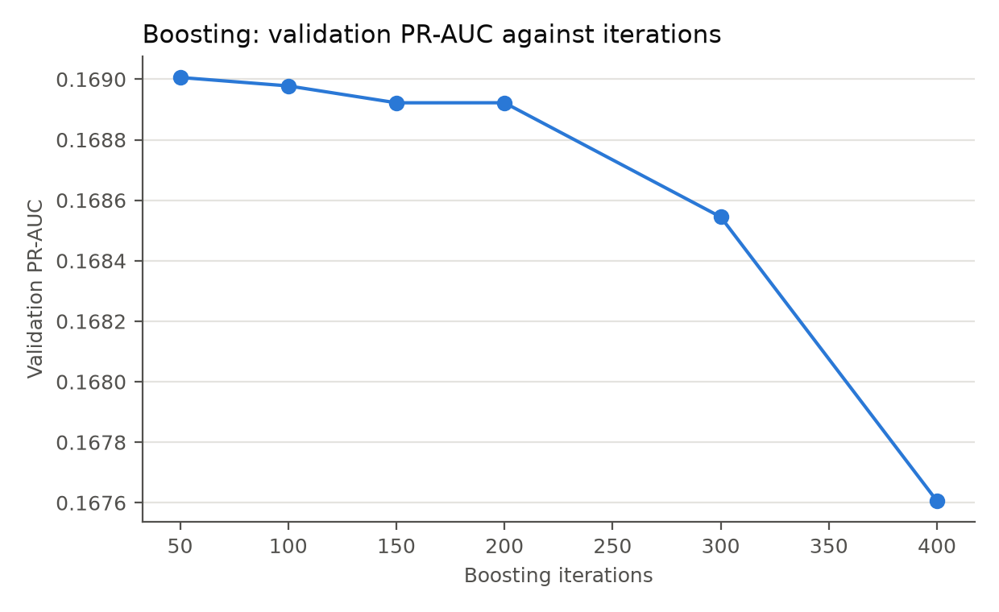
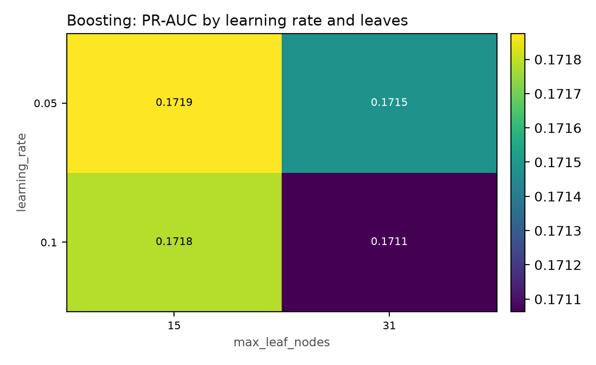
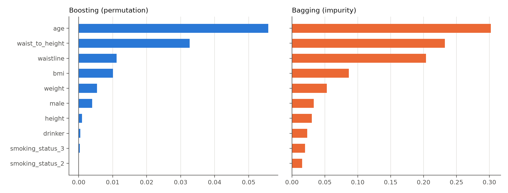
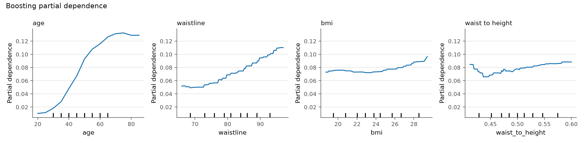
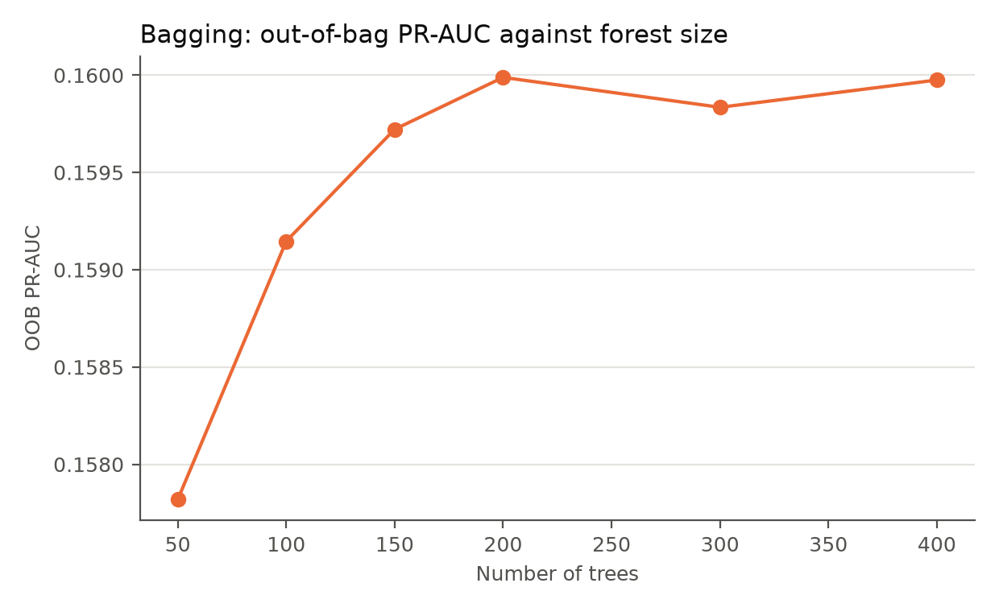
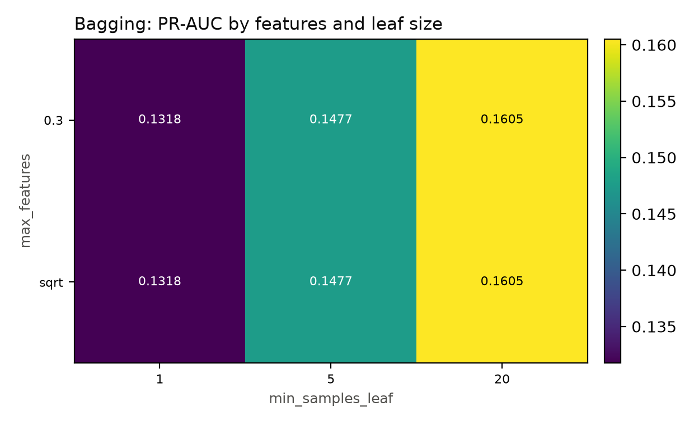

# 7.0 Boosting and Bagging

Sections 5–6 compared three single models. Each has a clear weakness: logistic regression cannot
represent non-linearities or interactions, the GAM can bend but cannot interact, and a single tree
can do both but is unstable. This section adds two ensembles that attack those weaknesses from
opposite directions. Boosting fits many weak trees sequentially, each one correcting the errors of
the current model; bagging fits many strong trees independently on bootstrap samples and averages
them. The two methods therefore reduce different components of the error: boosting mainly reduces
bias, bagging mainly reduces variance.

Both ensembles use the same ten questionnaire inputs, the same five stratified folds, the same
held-out test set and the same recall-0.80 threshold rule as §5. No laboratory or equipment
features are used, so the comparison with the basic models is like-for-like.

## 7.1 Choice of algorithms

The two ensembles are deliberately different, not two tunings of the same method.

**Boosting: histogram gradient-boosted trees (HGB).** The base learner is a shallow regression tree, typically
with 15–31 leaves. Trees are added one at a time. Each new tree is fitted to the negative gradient
of the logistic loss, which for the logit link is simply the residual $y-\hat p$. The update is
scaled by a learning rate, so no single tree can dominate. This is a bias-reduction method: the
model starts underfit and becomes progressively more flexible. It is the natural choice for
tabular data because it captures non-linearities and interactions without hand-crafted features,
and it remains fast at 800,000 rows.

**Bagging: random forest.** The base learner is a deep, high-variance tree. Many trees are grown
on bootstrap samples of the training set, and each split considers only a random subset of the
features. The forest averages the trees, which cancels much of their individual variance without
increasing bias. This is the canonical variance-reduction method for unstable trees. It is
parallel by construction and provides an out-of-bag error estimate for free.

The two methods therefore differ in both ensemble mechanism and base-tree capacity: sequential
shallow trees versus parallel deep trees; residual fitting versus bootstrap averaging. That is the
sense in which different algorithms are used for boosting and bagging.

## 7.2 Boosting: the algorithm

The model is built in function space. Let $F_0(x)$ be the constant log-odds of the base rate.
For iteration $m = 1,\ldots,M$:

1. Compute the current probability $\hat p_i = \sigma(F_{m-1}(x_i))$ and the negative gradient
   $r_i = y_i - \hat p_i$.
2. Fit a shallow regression tree $h_m$ to the residuals $r_i$, using the tree-size and
   leaf-size constraints.
3. Compute a leaf value $\gamma_{jm}$ for each leaf $j$ of the tree. For the logistic loss this
   is the Newton step
   $$
   \gamma_{jm} = \frac{\sum\limits_{i \in R_{jm}} r_i}{\sum\limits_{i \in R_{jm}} \hat p_i(1-\hat p_i)},
   $$
   where $R_{jm}$ is the set of training rows in leaf $j$.
4. Update the model:
   $$
   F_m(x) = F_{m-1}(x) + \nu\, h_m(x),
   $$
   where $\nu$ is the learning rate.
5. Stop when the validation loss has not improved for a fixed number of iterations, or when the
   maximum number of iterations is reached.

The final probability is $\hat p(x)=\sigma(F_M(x))$. The learning rate and the number of
iterations trade off against each other: a smaller rate needs more trees but usually generalizes
better. The tree size controls the order of the interactions the model can represent; a tree with
15 leaves can capture interactions among a handful of features, while a stump would be additive.
The minimum leaf size and the L2 penalty on the leaf values control overfitting. Early stopping
uses a validation fraction of each training fold, so the number of trees is chosen from data
rather than fixed in advance.

**Tuning.** The search covered learning rates of 0.05 and 0.1, 150 or 300 iterations, 15 or 31
leaves, a minimum leaf size of 20 or 50, and L2 penalties of 0 or 1. It used a stratified 300,000
row sample with three folds. The best configuration was a learning rate of 0.05, 150 iterations,
15 leaves, a minimum leaf size of 20 and no L2 penalty. The search score was 0.1719 PR-AUC.

## 7.3 Boosting: results

The refit on all 793,032 training rows reached a cross-validated PR-AUC of 0.1754 ± 0.0021 and a
test PR-AUC of 0.1744. The test ROC-AUC was 0.7481. At the frozen threshold the model reaches
recall 0.7968, precision 0.1356, F2 0.4033 and a referral rate of 45.2 %. Table 7.1 collects the
results.

| Model          | CV PR-AUC       | Test PR-AUC | Test ROC-AUC | Test recall | Test precision | Test F2 | Test referral |
| -------------- | --------------- | ----------- | ------------ | ----------- | -------------- | ------- | ------------- |
| Boosting (HGB) | 0.1754 ± 0.0021 | 0.1744      | 0.7481       | 0.7968      | 0.1356         | 0.4033  | 0.4517        |
| Bagging (RF)   | 0.1658 ± 0.0019 | 0.1657      | 0.7378       | 0.7959      | 0.1320         | 0.3968  | 0.4634        |

*Table 7.1: Cross-validated and test results for the two ensembles on the questionnaire features.
The threshold is the largest out-of-fold value with recall ≥ 0.80, applied once to the test set.*

*Figure 7.1: Validation PR-AUC against the number of boosting iterations, for the selected
learning rate and tree size. The total change is small (about 0.0014); the curve peaks early and
declines after about 200 iterations.*

The learning curve shows why early stopping matters. Validation performance is highest with a few
dozen to about 150 trees and then slowly declines as the model starts to fit noise. The y-axis is
deliberately narrow: the absolute differences are small, but the direction is consistent with the
cross-validated choice of 150 iterations.

*Figure 7.2: Cross-validated PR-AUC for the boosting search, by learning rate and maximum number
of leaves. The best region is a low learning rate with small trees.*

The heatmap shows the same story as the search. A learning rate of 0.05 with 15 leaves is best;
increasing the trees to 31 leaves lowers the score, and a learning rate of 0.1 with 31 leaves is
the worst combination. The model prefers many small, slowly added trees over a few large ones.
This is consistent with the bias-reduction view: small trees keep the variance low while the
sequence of trees builds the signal.

*Figure 7.3: Feature importance for the two ensembles. Left: permutation importance for boosting
(drop in PR-AUC when a feature is shuffled). Right: impurity importance for the forest.*

Age dominates both ensembles, followed by waist-to-height ratio, waist circumference and BMI.
This is the same ranking as the logistic regression, GAM and single tree in §5, even though the
ensembles can represent interactions. The fact that a high-capacity model still concentrates on
the same features is evidence that the questionnaire signal is mostly age and body size, not a
complex interaction that the simpler models missed.

*Figure 7.4: Partial dependence of the boosted model for age, waist circumference, BMI and
waist-to-height ratio.*

The partial-dependence curves are consistent with the GAM: risk rises steeply with age and
steadily with waist circumference, while BMI and waist-to-height ratio rise modestly after their
mid-range. The boosted model is less smooth than the GAM, but the direction is the same.

## 7.4 Bagging: the algorithm

Bagging trains $B$ base models on independent bootstrap samples and averages their predictions.
For a forest, each tree is grown deep and each split considers a random subset of the features.
The steps are:

1. For $b = 1,\ldots,B$, draw a bootstrap sample of size $n$ with replacement from the training
   set.
2. Grow a deep decision tree on the bootstrap sample. At each node, consider only a random subset
   of the features when choosing the split. Stop when the leaf-size and depth constraints are met.
3. Store the tree and its out-of-bag rows, i.e. the training rows that were not drawn in that
   bootstrap sample.
4. Aggregate the trees by averaging their predicted probabilities:
   $$
   \hat p(x) = \frac{1}{B}\sum_{b=1}^{B}\hat p_b(x).
   $$
5. Estimate generalization error from the out-of-bag predictions: each training row is predicted
   only by the trees for which it was out of bag.

The bootstrap and the random feature subset are two sources of diversity. The bootstrap changes
which rows each tree sees; the feature subset changes which splits are available. Averaging
uncorrelated trees reduces variance without increasing bias, which is exactly what a single deep
tree needs. The number of trees controls the Monte Carlo error of the average; the minimum leaf
size and maximum depth control the variance of each tree. Class weights can be used, but the
unweighted forest was better here, and the threshold handles the imbalance.

**Tuning.** The search covered 200 or 400 trees, square-root or 30 % feature sampling, minimum
leaf sizes of 1, 5 or 20, a maximum depth of 20 or none, and unweighted versus balanced
subsample weights. It used the same 300,000-row sample and three folds. The best configuration was
400 trees, square-root features, a minimum leaf size of 20, a maximum depth of 20 and no class
weighting. The search score was 0.1605 PR-AUC.

## 7.5 Bagging: results

On the full training set the forest reached a cross-validated PR-AUC of 0.1658 ± 0.0019 and a test
PR-AUC of 0.1657. The test ROC-AUC was 0.7378. At the frozen threshold it reaches recall 0.7959,
precision 0.1320, F2 0.3968 and a referral rate of 46.3 %. These are close to the logistic
regression and below the GAM and the boosted model.

*Figure 7.5: Out-of-bag PR-AUC as trees are added to the forest. The curve rises quickly and
plateaus after roughly 150–200 trees.*

The out-of-bag curve explains the choice of 400 trees: most of the gain is obtained by 150–200
trees, and additional trees only reduce Monte Carlo noise. The plateau is flat, so a smaller
forest would have been acceptable; 400 trees were kept for stability.

*Figure 7.6: Cross-validated PR-AUC for the bagging search, by maximum features per split and
minimum leaf size. Regularizing the leaves matters much more than the feature fraction.*

The heatmap is the most informative result for bagging. With a minimum leaf size of 1 or 5, the
forest scores 0.132–0.148 PR-AUC; with 20 it reaches 0.1605. Deep, unregularized trees overfit the
training folds, and averaging does not fully repair that. The feature fraction (square-root versus
30 %) makes almost no difference, which is expected because the features are highly correlated:
most random subsets carry the same age-and-body-size signal.

## 7.6 Boosting versus bagging

The two ensembles behave as the bias–variance argument predicts. Boosting is the stronger of the
two: 0.1744 test PR-AUC against 0.1657 for bagging, and 0.7481 ROC-AUC against 0.7378. It also
reaches a slightly better operating point (precision 13.56 % against 13.20 %, F2 0.4033 against
0.3968). Bagging is essentially tied with logistic regression (0.1657 against 0.1656), which suggests
that the single tree's instability was not the main limitation; the signal is close to additive, and averaging deep trees
does not create information that the linear model lacks.

The cost is very different. Boosting fits in about 4.5 s on the full training set and predicts
173 ms per 100,000 rows. The forest fits in about 50 s and predicts 1.05 s per 100,000 rows. The
forest is therefore roughly eleven times slower to fit and six times slower to predict, for a
worse score. That is a strong argument for boosting on this problem.

The comparison with the basic models is left to §8, where the boosted model, the forest, the best
basic model and the transfer student are compared on identical folds and test rows.

## 7.7 Limitations

- **Tuning is on a subsample.** Both searches used 300,000 rows and three folds. The selected
  hyperparameters are plausible, but a full five-fold search on 793,032 rows could shift them.
- **Early stopping is internal.** Boosting uses a validation fraction inside each training fold.
  This is not the same as an outer validation loop, and the reported scores are slightly
  optimistic.
- **One feature set.** The ensembles use only the ten questionnaire inputs. They do not test
  whether laboratory values would change the ranking; §8 uses the full-feature teacher for the
  transfer experiment.
- **Interpretability.** Feature importance and partial dependence are summaries, not causal
  effects. Correlated body-size features share credit, and impurity importance favours features
  with many split points.
- **Threshold transfer.** The threshold is chosen out-of-fold and applied once to the test set, so
  the test recall is close to, but not exactly, 0.80.
- **Compute.** The forest is expensive at this scale. The result is reported, but a production
  system would need to justify 50 s of training and 1 s per 100,000 predictions against the
  cheaper boosted model.

## References used in this section

Breiman, L. (1996). Bagging predictors. *Machine Learning, 24*(2), 123–140.
https://doi.org/10.1007/BF00058655

Breiman, L. (2001). Random forests. *Machine Learning, 45*(1), 5–32.
https://doi.org/10.1023/A:1010933404324

Friedman, J. H. (2001). Greedy function approximation: A gradient boosting machine. *Annals of
Statistics, 29*(5), 1189–1232. https://doi.org/10.1214/aos/1013203451

Hastie, T., Tibshirani, R., & Friedman, J. (2009). *The elements of statistical learning: Data
mining, inference, and prediction* (2nd ed.). Springer.
