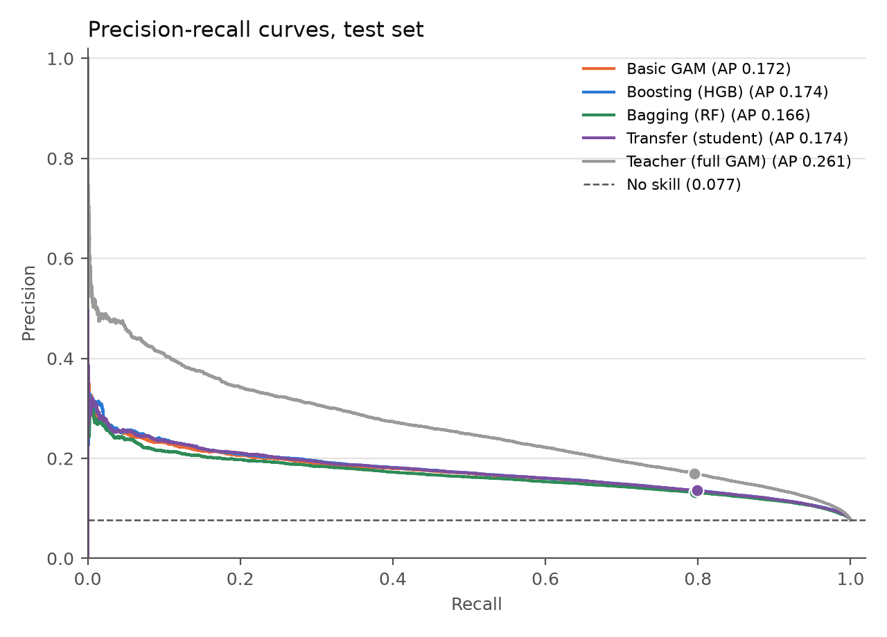
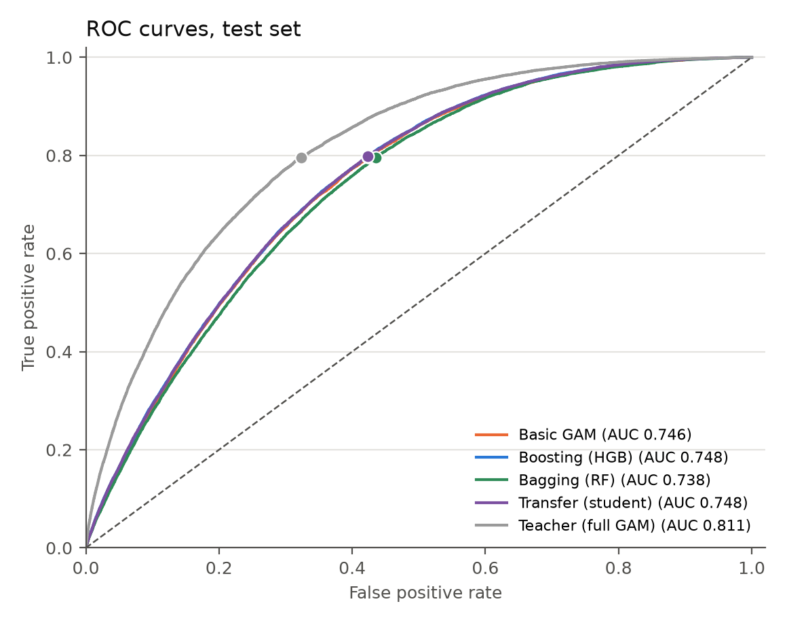
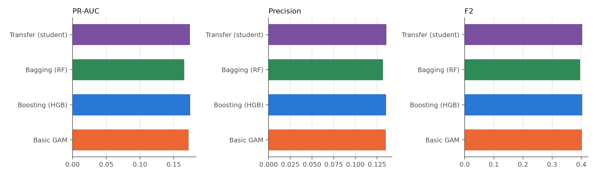
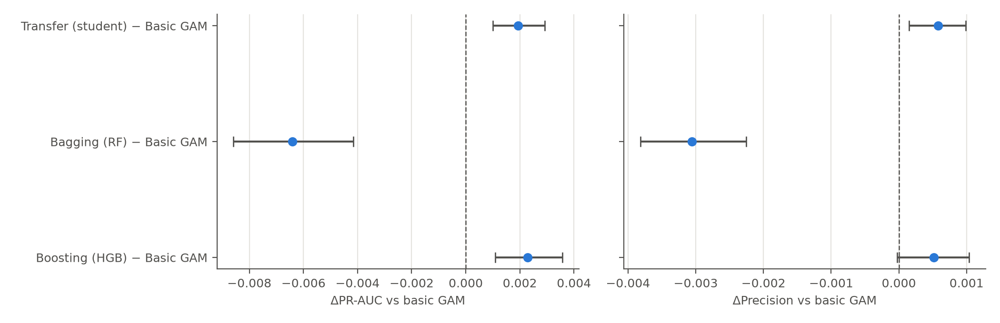
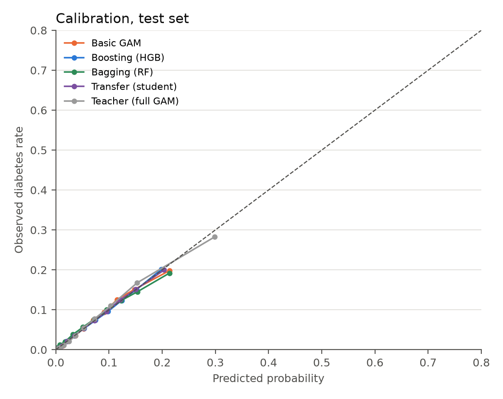
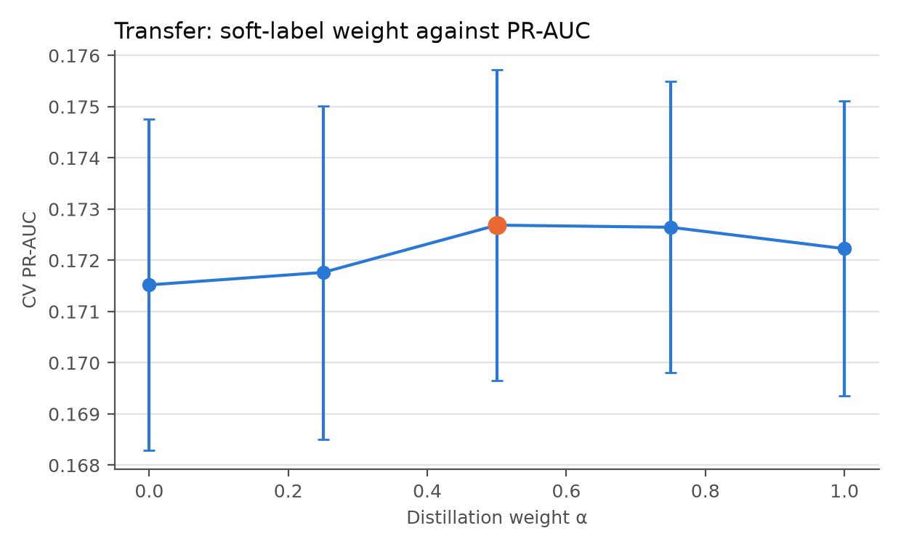
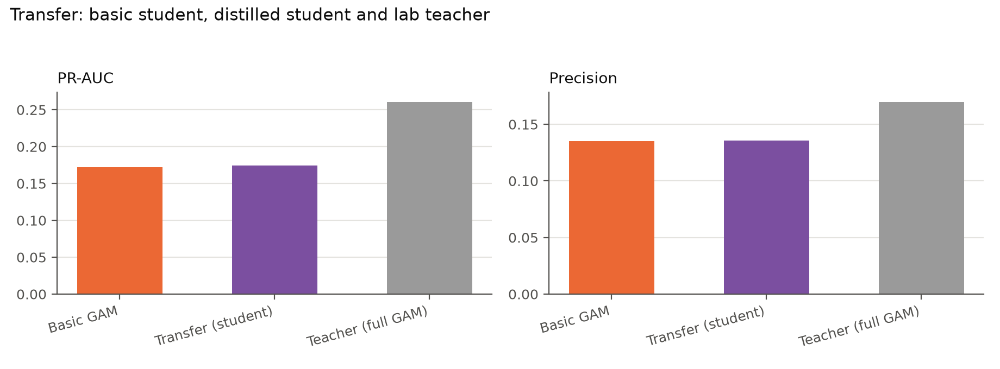
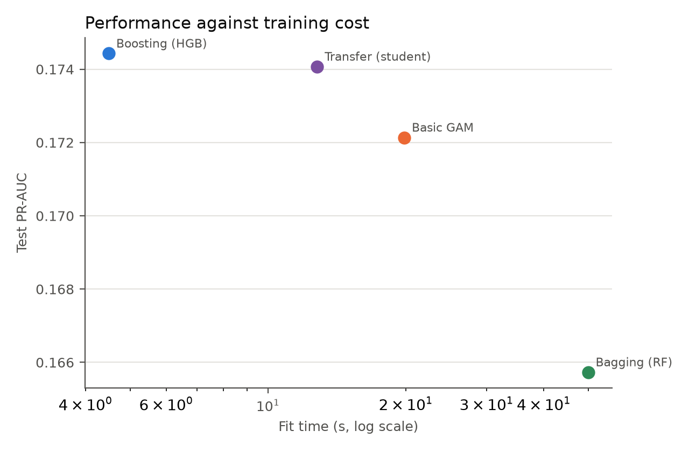

# 8.0 Final Comparison: Basic, Boosting, Bagging and Transfer

Sections 5–7 produced four deployable questionnaire models: the best basic model (the GAM), the
boosted trees, the random forest and the distilled transfer student. This section compares them on
the same test set, folds and recall-0.80 threshold. It also keeps the full-feature GAM as an upper
reference, because that model uses laboratory values that are not available to the deployable
models.

## 8.1 Models compared

- **Basic GAM** — the best of the three models in §5 (test PR-AUC 0.1721).
- **Boosting** — histogram gradient-boosted shallow trees (§7; 0.1744).
- **Bagging** — a random forest of deep trees (§7; 0.1657).
- **Transfer** — a questionnaire-only HGB student distilled from the full-feature GAM teacher
  (§8.4; 0.1741).
- **Teacher reference** — the full-feature GAM, which uses the ten laboratory values. It is not a
  deployable screening model because it requires a blood sample, but it shows the ceiling that the
  laboratory data provides.

All models use the same threshold rule: the largest out-of-fold threshold with recall at least
0.80, frozen before the test set is used. Table 8.1 gives the test results and the cost.

| Model | PR-AUC | ROC-AUC | Brier | Log loss | Recall | Precision | F2 | Referral | NNS | Fit (s) | Predict (ms/100k) |
|---|---|---|---|---|---|---|---|---|---|---|---|
| Basic GAM | 0.1721 | 0.7457 | 0.0671 | 0.2427 | 0.7970 | 0.1350 | 0.4024 | 0.4536 | 7.41 | 19.8 | 208 |
| Boosting (HGB) | 0.1744 | 0.7481 | 0.0670 | 0.2417 | 0.7968 | 0.1356 | 0.4033 | 0.4517 | 7.38 | 4.5 | 173 |
| Bagging (RF) | 0.1657 | 0.7378 | 0.0674 | 0.2448 | 0.7959 | 0.1320 | 0.3968 | 0.4634 | 7.58 | 50.0 | 1,051 |
| Transfer (student) | 0.1741 | 0.7478 | 0.0670 | 0.2418 | 0.7986 | 0.1356 | 0.4038 | 0.4525 | 7.38 | 12.8 | 223 |
| Teacher (full GAM) | 0.2607 | 0.8106 | 0.0633 | 0.2239 | 0.7953 | 0.1698 | 0.4580 | 0.3599 | 5.89 | 140.3 | 1,132 |

*Table 8.1: Test-set comparison at the frozen recall-0.80 thresholds. NNS = 1 / precision. Fit and
prediction times are for the final model on this machine (22 CPU cores, no GPU). The teacher uses
28 features and is not deployable without a blood sample.*

## 8.2 Ranking and operating point

The boosted model has the highest point estimate among the deployable models (0.1744), followed
closely by the transfer student (0.1741) and the basic GAM (0.1721). The forest is lower (0.1657).
The ordering is the same for ROC-AUC. The differences among the top three are small: 0.0023
PR-AUC between boosting and the GAM, and 0.0020 between transfer and the GAM.

| Comparison | ΔPR-AUC | 95 % CI | ΔROC-AUC | Δprecision | Δrecall | Δreferral |
|---|---|---|---|---|---|---|
| Boosting − basic GAM | +0.0023 | [+0.0011, +0.0036] | +0.0024 | +0.0006 | −0.0002 | −0.0019 |
| Bagging − basic GAM | −0.0064 | [−0.0086, −0.0041] | −0.0079 | −0.0030 | −0.0011 | +0.0098 |
| Transfer − basic GAM | +0.0020 | [+0.0010, +0.0029] | +0.0021 | +0.0006 | +0.0016 | −0.0011 |
| Boosting − transfer | +0.0003 | [−0.0001, +0.0009] | +0.0003 | +0.0000 | −0.0018 | −0.0008 |

*Table 8.2: Paired test-set differences against the basic GAM. Positive ΔPR-AUC, ΔROC-AUC,
Δprecision or Δrecall favours the first model; a negative Δreferral means fewer patients referred.*

The paired bootstrap in Figure 8.4 formalizes the comparison. Boosting is +0.0023 PR-AUC over
the GAM (95 % CI +0.0011 to +0.0036), transfer is +0.0020 (+0.0010 to +0.0029), and the forest is
−0.0064 (−0.0086 to −0.0041). Boosting and transfer are statistically indistinguishable
(+0.0003, CI −0.0001 to +0.0009), so the distillation step does not add a robust gain.

*Figure 8.1: Precision-recall curves on the test set for the four deployable models and the
full-feature teacher.*

*Figure 8.2: ROC curves on the test set.*

*Figure 8.3: PR-AUC, precision and F2 for the deployable models.*

*Figure 8.4: Paired differences against the basic GAM, with 95 % bootstrap intervals.*

At the operating point all four deployable models refer 45–46 % of patients to catch about 80 % of
cases. Precision is 13.2–13.6 %, NNS is 7.4–7.6, and the models miss 3,060–3,161 cases in the
198,258-row test set. The boosted model and the transfer student have the best precision and the
lowest referral rate; the forest is slightly worse. The differences are small in patient terms:
the choice is not forced by the data.

## 8.3 Calibration

*Figure 8.5: Calibration on the test set. All four deployable models track the diagonal closely.*

The Brier scores are 0.0670–0.0674 and the log losses 0.2417–0.2448. Boosting and transfer have
the lowest Brier and log loss, the GAM is a hair behind and the forest is the worst of the four,
though all are close. Calibration is not the deciding factor here; the ranking differences are
larger than the calibration differences.

## 8.4 The transfer experiment

The teacher is the full-feature GAM from §6.6: it sees the ten questionnaire inputs plus the eight
equipment measurements and the ten laboratory values, and reaches a test PR-AUC of 0.2607. The
student is the questionnaire-only HGB from §7. The student never sees the laboratory features at
prediction time.

The teacher's out-of-fold probabilities are used as soft targets. For a distillation weight
$\alpha$, each training row contributes three weighted copies:

- the true label with weight $1-\alpha$,
- a positive teacher target with weight $\alpha t_i$,
- a negative teacher target with weight $\alpha(1-t_i)$,

where $t_i$ is the teacher probability. This is equivalent to a soft-label logistic loss for
the student and can be fitted with ordinary sample weights. $\alpha=0$ is the plain HGB
baseline; $\alpha=1$ uses only the teacher.

| Distillation weight α | CV PR-AUC |
|---|---|
| 0.00 | 0.1715 ± 0.0032 |
| 0.25 | 0.1718 ± 0.0033 |
| 0.50 | 0.1727 ± 0.0030 |
| 0.75 | 0.1726 ± 0.0028 |
| 1.00 | 0.1722 ± 0.0029 |

*Table 8.3: Distillation-weight sweep on a 300,000-row tuning sample, three folds. The best weight
is 0.50, but all intervals overlap.*

*Figure 8.6: Cross-validated PR-AUC against the distillation weight.*

The best weight is 0.50, but the gain over no transfer is only 0.0012 PR-AUC on the tuning sample,
and it disappears on the full-data test: the student reaches 0.1741, against 0.1744 for plain
boosting. The paired difference (boosting − transfer) is +0.0003 PR-AUC (95 % CI −0.0001 to
+0.0009), so the transfer student is not better than the model it was distilled from. The
teacher's 0.2607 is not transferred: the laboratory information is not present in the questionnaire
features, and soft labels cannot create it.

*Figure 8.7: Basic GAM, distilled student and full-feature teacher. The teacher is an upper
reference, not a deployable screening model.*

The practical conclusion is that transfer is not worth its extra complexity here. A teacher must be
trained on the full-feature data, the student must be fitted on the expanded soft-label set, and
the result is indistinguishable from plain boosting. The laboratory values help only when they are
measured.

## 8.5 Complexity and computation time

*Figure 8.8: Test PR-AUC against training time. The x-axis is logarithmic.*

The cost ordering is clear. Boosting is both the best deployable model and the cheapest to fit
(4.5 s) and predict (173 ms per 100,000). The GAM is slower to fit (19.8 s) but similar to predict
(208 ms) and much easier to explain. The forest is dominated: 50 s to fit and 1,051 ms to predict
for a lower PR-AUC. The transfer student costs 12.8 s to fit and 223 ms to predict; the extra
training time comes from the three-copy soft-label expansion and the teacher, and it buys no
measurable gain. The teacher itself costs 140 s to fit and 1,132 ms to predict, but it is not a
deployment candidate.

The complexity argument matches the measurements:

- **Boosting** adds shallow trees sequentially; training is linear in the number of iterations and
  rows, and prediction is a sum over a small number of trees.
- **Bagging** grows many deep trees; training is linear in the number of trees but each tree is
  larger, and prediction visits every tree.
- **Transfer** adds a teacher fit and a threefold expansion of the student's training set. It is
  more complex than plain boosting and no better on this problem.
- **The GAM** fits a spline basis and a penalized linear model; it is slower than boosting but its
  prediction cost is competitive and its coefficients and partial effects are directly readable.

## 8.6 Conclusion

For the questionnaire-only screening problem, boosting has the highest point estimate among the
four deployable models, but it is statistically tied with the transfer student; both are slightly
above the GAM. Boosting is also the cheapest to train and predict. The basic GAM is almost as
good and much easier to explain, so it remains a defensible choice when interpretability matters
more than the last 0.002 PR-AUC. The random forest is not competitive. Transfer from the
laboratory teacher does not help: the student is statistically indistinguishable from plain
boosting, and it cannot recover the teacher's 0.2607 because the laboratory information is absent
from the questionnaire.

The laboratory model remains the upper bound. It reaches 0.2607 PR-AUC and 17.0 % precision at a
36 % referral rate, against 0.174 and 13.6 % for the best questionnaire model. The gap is the price
of not taking a blood sample. Within the questionnaire-only setting, the signal is mostly age and
body size, and the choice of algorithm changes the result much less than the choice of features.

## 8.7 Limitations

- **One test set.** All comparisons use the same Korean NHIS hold-out. No external validation was
  performed.
- **Threshold transfer.** The thresholds are chosen out-of-fold and applied once to the test set;
  the test recalls are close to, but not exactly, 0.80.
- **Tuning on subsamples.** The ensembles were tuned on 300,000 rows with three folds. Full-data
  tuning could shift the hyperparameters and the ranking slightly.
- **Transfer leakage caveat.** The teacher's out-of-fold probabilities are used as soft targets.
  This is standard stacking, but a fully nested teacher fit inside every student fold would be
  stricter.
- **Teacher is not deployable.** The full-feature model is a reference, not a screening tool; it
  requires a blood sample.
- **No cost-effectiveness analysis.** NNS and referral rate are proxies; the actual cost of the
  blood test, clinic time and patient burden is outside the scope.

## References used in this section

Hinton, G., Vinyals, O., & Dean, J. (2015). Distilling the knowledge in a neural network.
*arXiv:1503.02531*. https://arxiv.org/abs/1503.02531

Breiman, L. (1996). Bagging predictors. *Machine Learning, 24*(2), 123–140.
https://doi.org/10.1007/BF00058655

Friedman, J. H. (2001). Greedy function approximation: A gradient boosting machine. *Annals of
Statistics, 29*(5), 1189–1232. https://doi.org/10.1214/aos/1013203451
